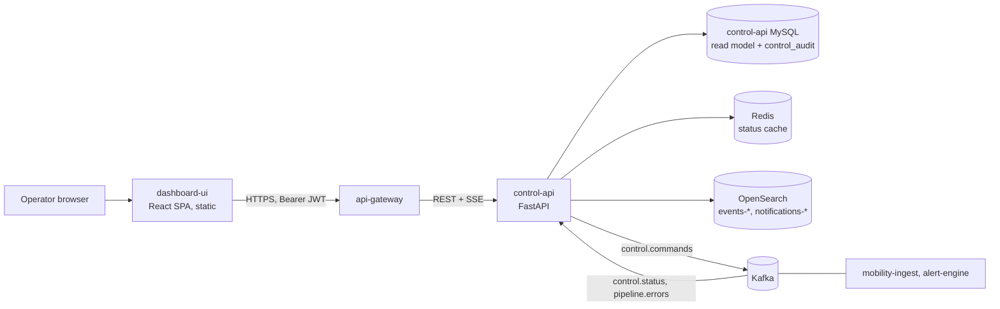

# Dashboard and API Gateway — Quick Design

**Status:** draft for review. Not yet approved, so no implementation plan exists. Builds on section 7 of
`2026-11-04-motorist-mobility-pipeline-design.md`. API contract: `docs/api/dashboard-gateway.openapi.yaml`.

## 1. Purpose and assumptions

Operators need one place to see whether the pipeline is healthy and to act when it is not: pause a feed,
retry errors, replay the DLQ, force a circuit. This replaces the throwaway artifact dashboard.

| Said by the user | Assumed by this draft (correct me) |
|---|---|
| Dashboard is built with React, as its own service | `dashboard-ui`: React + TypeScript SPA, served by its own container |
| There is an API gateway service | A **thin edge gateway** in front of `control-api`: auth, roles, routing, CORS, rate limit, request ids. No business logic |
| (not said) | The UI talks only to the gateway. The gateway talks only to `control-api`. `control-api` never calls domain services (spec section 2.7) |

The spec has no gateway today. On approval, section 2.5, 2.7 and 7 of the pipeline spec get one added line
each.

## 2. Architecture



Why a gateway at all: one stable origin for the UI, one place for tokens and roles, and a place to add
other APIs later (for example an alert-engine API) without the UI changing. If it stays a pure proxy it
adds little over calling `control-api` directly; that is why it is kept thin and its only jobs are the five
above.

**Control actions are asynchronous.** A `POST` returns **202** with an `audit_id`. The UI shows the action as
*issued*, then flips to *applied* or *failed* when the stream delivers the matching `audit` event. The UI
never assumes a command worked.

## 3. React app

| Concern | Choice | Reason |
|---|---|---|
| Build | Vite + React 18 + TypeScript (strict) | Static output, fast dev loop |
| Routing | React Router | Deep links such as `/errors/mobility-ingest/<fingerprint>` |
| Server state | TanStack Query | Caching, retries, polling fallback |
| API client | `openapi-typescript` + `openapi-fetch`, generated from the OpenAPI file | Types cannot drift from the contract |
| Live updates | One SSE connection (`/api/v1/stream`) via a fetch-based reader, patching the Query cache | Header auth works; one connection for the whole app |
| Charts | Recharts | Enough for bars, lines, sparklines |
| UI kit | Radix primitives + CSS variables, light and dark | Accessible, no heavy theme layer |
| Tests | Vitest + Testing Library; Playwright for two flows (pause a feed, retry an error) | Cover the actions that change state |

```
dashboard-ui/
  src/
    api/          generated types + client, auth header, problem-details handling
    stream/       SSE reader, cache patching
    features/
      overview/  pipeline/  errors/  feeds/  outbox/  search/  rules/  audit/
    components/   StatusPill, Sparkline, DataTable, ConfirmAction, EmptyState
    routes.tsx    role-gated routes
```

Role gating is a convenience only: the gateway enforces roles. The UI hides a button the user cannot use
and explains why in a tooltip.

## 4. Screens

Each screen names the endpoint it reads. Status is shown by form (pill, stripe) and not only by number.

**Overview** (`GET /overview`, `GET /services`)
```
+--------------------------------------------------------------------+
| One status line: "2 steps failing, outbox oldest 4 min"   [Last 60m]|
+----------+----------+----------+----------+------------------------+
| Services | Feeds    | Open     | Outbox   | Worst step             |
| 3 running| 1 paused | errors 5 | pending 12| webhook  failing  p95…|
+----------+----------+----------+----------+------------------------+
| Service instances: name | state | heartbeat age | lag | error rate  |
+--------------------------------------------------------------------+
```

**Pipeline map** (`GET /pipeline/steps`) — the ten steps as a graph, colour by error rate, counts of
ok/retry/failed, p95, backlog. Click a step to open Errors filtered to it.

**Errors** (`GET /errors`, `GET /errors/{service}/{fingerprint}`)
```
Filters: service | step | category | status | time        [Retry category]
+------+----------+------------------+--------+-----+-----------+
| step | category | message          | status | x N | last seen |
+------+----------+------------------+--------+-----+-----------+
Detail drawer: cause in plain words, suggested action, stack trace,
context ids, link to raw_fetch or quarantine, [Retry] [Ignore]
```

**Feeds** (`GET /feeds`) — one card per feed: last success, consecutive failures, lease holder and
fencing token, [Pause] [Resume] [Replay range]. Replay asks for a range and a confirmation.

**Outbox and DLQ** (`GET /outbox`, `GET /dlq`) — backlog per sink with age of the oldest row and last error;
DLQ table with multi-select and [Replay selected].

**Search and journey** (`GET /events/search`, `GET /journey`) — search events by entity (`HE12:C`), then open
a journey for an `event_id` or `trace_id`: the ten steps with ok, retrying, failed or not reached.

**Rules and circuits** (`GET /rules`, `GET /circuits`) — enable or disable a rule (admin); force a circuit
open or closed (operator), with the forced state clearly marked.

**Audit** (`GET /audit`) — every control action with actor, target, result.

## 5. Behaviour that is easy to get wrong

- **Staleness.** A heartbeat older than 30 seconds (the spec's `status:{instance_id}` TTL) renders the
  instance as *unknown*, not as its last state.
- **Destructive actions** (replay, retry category, force circuit) use a confirmation that names the target
  and the count affected.
- **Idempotent actions.** A second click while a command is *issued* is disabled, not queued.
- **Errors.** Problem details map to one inline message with the gateway's `request_id` for support. A
  stream disconnect shows a quiet "live updates paused" and falls back to polling every 15 seconds.
- **Secrets.** No webhook paths or tokens reach the browser. Circuits show host only.

## 6. First slice (what to build first)

The smallest end-to-end cut that shows real data:

1. `mobility-ingest` publishes a heartbeat with `outbox_backlog` and feed state to `control.status`.
2. `control-api`: consume `control.status`, serve `GET /services`, `GET /feeds`, `GET /outbox`, `GET /overview`.
3. `api-gateway`: JWT check, role claim, proxy, `/health`.
4. `dashboard-ui`: Overview and Feeds screens, generated client, auth.

Everything else in the OpenAPI file is the target surface and is built screen by screen afterwards. Pause
and resume come right after the slice because they prove the full command round trip.

## 7. Decisions needed before a plan can be written

1. **Gateway technology. DECIDED: FastAPI** (plus `httpx` streaming), so the backend stays one language, SSE
   passes through, and role rules and problem details are plain tested code. Considered and not chosen:
   Nginx (`auth_request` to a verify endpoint, fewer lines but role logic lives in config), Traefik, Envoy.
   `dashboard-ui` static files are served by its own small container, not by the gateway.
2. **Identity provider.** Who issues the JWT and where the `role` claim comes from. For local compose a
   static dev issuer is enough; production needs a real provider.
3. **Scope of the first plan.** Slice in section 6, or the full set of screens.
4. **Spec amendments.** Whether to add the gateway to the pipeline spec now or when the plan is written.
