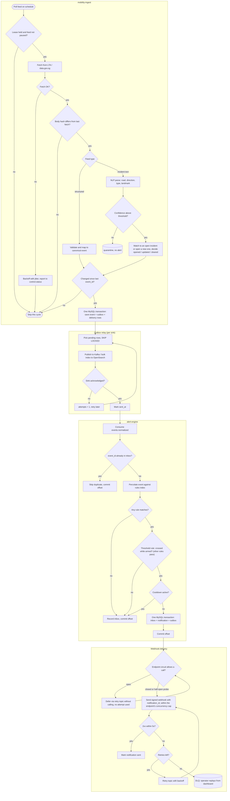
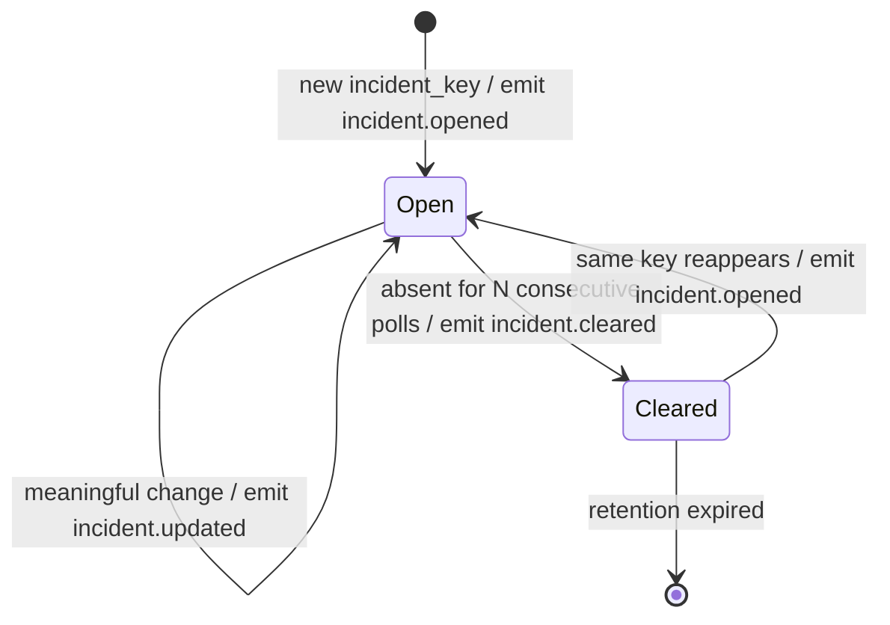
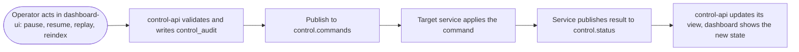
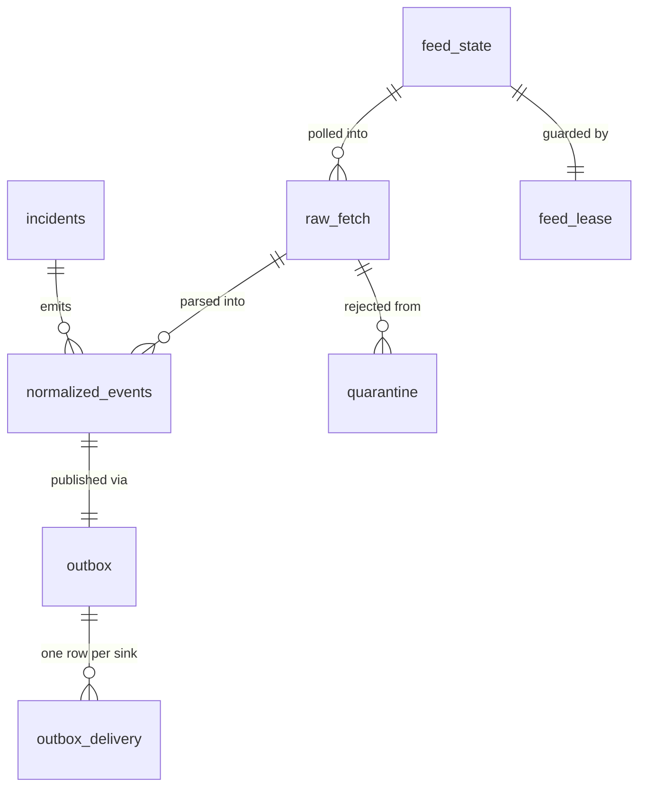
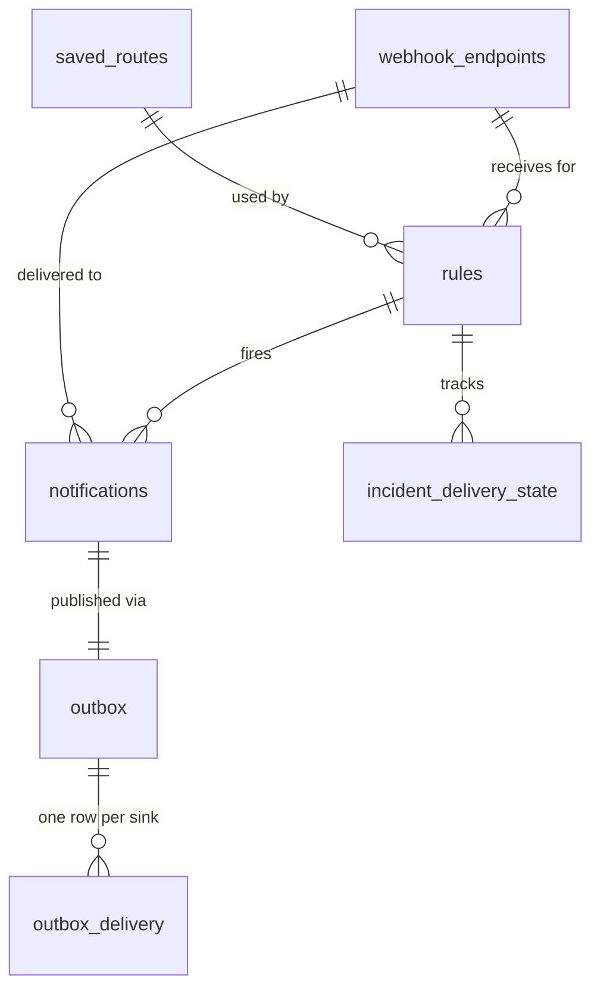
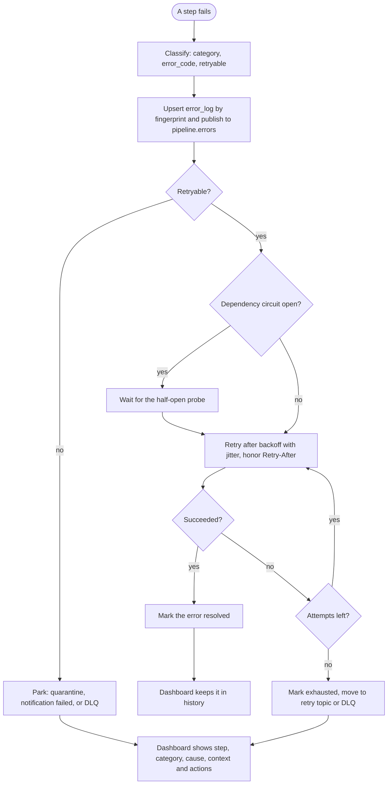

# Motorist Mobility Pipeline — Design Spec

Date: 2026-11-04
Status: Draft, awaiting review
Stack: Python, Kafka, MySQL, Redis, OpenSearch
Target: real prototype to pitch to Motorist (motorist.sg)

## 1. Purpose

Motorist is a Singapore vehicle-owner super app (about 2M motorists, 3,400 partners). Its public
product shows traffic cameras, parking, ERP 2.0 companion alerts, COE results, fuel prices and
per-vehicle reminders. It exposes no public data API, and its alerts look like simple expiry reminders.

This project is a backend data pipeline that turns public mobility feeds into **real-time,
personalized, geo-aware alerts**, with the properties of a production data system:
high availability, fault tolerance, scalability and no data loss.

### Success criteria
- No event accepted by `mobility-ingest` is ever lost, including through crashes of any single
  component or a Kafka/OpenSearch outage.
- Duplicate deliveries never cause duplicate user notifications.
- Any service can be paused, resumed and replayed from the dashboard.
- Any OpenSearch index can be rebuilt from MySQL/Kafka without data loss.
- A single failure of one broker, one service instance or one OpenSearch node does not stop the pipeline.

### Non-goals
- No user-facing mobile app. Notifications are delivered by signed webhook; other channels are out of scope.
- No payments, listings or valuation (a possible later domain).
- No claim of exactly-once delivery. The guarantee is at-least-once plus idempotent effects.

### 1.1 Pain points we focus on

These are **inferred from Motorist's public product and the nature of the data**, not from inside
knowledge. They are hypotheses to validate with Motorist before the pitch. We deliberately solve only two.

| # | Pain point | Why it hurts | How the services handle it | Where |
|---|---|---|---|---|
| 1 | **Alerts are generic, not contextual.** Reminders are mostly expiry dates (road tax, insurance). Time-sensitive, location-sensitive events (carpark filling up near me, ERP rate rising on my route, COE result) are not turned into personal alerts. | Low relevance and low engagement. Users get nothing at the moment it would help. | `alert-engine` stores each user's rule (geo-fence plus threshold plus cooldown) and matches every incoming event against all rules in one OpenSearch percolator call. Cooldown stops spam. | section 4, section 5 |
| 2 | **Traffic incidents are raw text, so they cannot become route-aware alerts.** LTA incident messages are short free text (road, direction, cause all inside one sentence), and the same incident reappears across many updates. Sent as-is, an alert says nothing about the user's route and repeats itself. | An alert that is irrelevant or repeated gets ignored or muted, which also wastes the value of pain point 1. | `mobility-ingest` runs an NLP step on incident text: it extracts road, direction, incident type and nearest landmark, groups repeated reports into one incident with a lifecycle (opened, updated, cleared), and emits a structured event. `alert-engine` can then match it to a user's saved route or geo-fence and alert once per real change. | section 3.1, section 4 |

Scalability, high availability and the dashboard are engineering properties that support these two
pain points. They are not separate problems we claim to solve.

## 2. High-Level Design

### 2.1 System context

```
 EXTERNAL SOURCES              THIS SYSTEM                         CONSUMERS
 ----------------      -----------------------------      ---------------------------
 LTA DataMall   --\                                    /-- Motorist app / partner systems
 data.gov.sg    ---+-->  Mobility Event Pipeline  ----+---  (alerts via email / webhook)
 (carpark, ERP,    |     (2 microservices + platform)  \-- Operators (Dashboard UI)
  incidents, fuel, |
  COE)         ----/
```

The system sits between public data sources and Motorist's channels. Inbound it is **pull-based**
(polling external APIs). Outbound it is **push-based** (notifications) plus a read API and dashboard
for operators. Integration with Motorist is by webhook now and can later be a Kafka topic or REST API.

### 2.2 Logical layers

| Layer | Responsibility | Components |
|---|---|---|
| Acquisition | Fetch and validate external data | `mobility-ingest` (feed adapters, normalizer) |
| Transport | Durable, ordered, replayable event log | Kafka topics, outbox relay |
| Processing | Match events to user intent, enforce idempotency | `alert-engine` (inbox, percolator matching, cooldowns) |
| Storage | System of record plus projections | MySQL (truth), OpenSearch (search/match), Redis (ephemeral) |
| Delivery | Send notifications reliably | Channel senders, retry topic, DLQ |
| Control and observability | Operate and observe the system | `control-api`, `dashboard-ui`, `control.*` topics |

### 2.3 End-to-end data flow

1. `mobility-ingest` polls a feed and normalizes the response.
2. It commits `normalized_events` + `outbox` in one MySQL transaction.
3. The relay publishes to Kafka (`events.normalized`) and indexes to OpenSearch (`events-*`).
4. `alert-engine` consumes the event, records it in its inbox, and percolates it against `rules`.
5. Each matching rule produces one notification row plus an outbox row, in one transaction.
6. The relay publishes `notifications.requested`. Channel senders deliver with retry, then DLQ.
7. Every stage emits heartbeats and metrics to `control.status` for the dashboard.

### 2.4 Kafka topics

| Topic | Producer | Consumer | Key | Partitions / retention |
|---|---|---|---|---|
| `events.normalized` | mobility-ingest | alert-engine | entity_id | 12 / 7 days |
| `events.normalized.retry` / `.dlq` | alert-engine | alert-engine / operator | entity_id | 12 / 14 days |
| `notifications.requested` | alert-engine | channel senders | user_id | 12 / 7 days |
| `notifications.retry` / `.dlq` | senders | senders / operator | user_id | 12 / 14 days |
| `control.commands` | control-api | all services | target service id | 1 / compacted |
| `control.status` | all services | control-api | service instance id | 3 / 1 day |
| `pipeline.errors` | all services (via outbox) | control-api | service + fingerprint | 3 / 14 days |

Partition counts are the unit of horizontal scale: consumers in a group scale up to the partition count.
Keying by `entity_id` / `user_id` preserves per-entity ordering.

### 2.5 Deployment and high availability view

```
  Delivered as BOTH docker-compose (local/demo) and Kubernetes manifests (pitch/production-like)

  +------------------+  +------------------+   +-----------------------------+
  | mobility-ingest  |  | alert-engine     |   | control-api + dashboard-ui  |
  | x2 (leader per   |  | xN (consumer     |   | x2 behind a load balancer   |
  |  feed via lock)  |  |  group)          |   +-----------------------------+
  +--------+---------+  +---------+--------+
           |                      |
  +--------v----------------------v------------------------------------------+
  | Kafka x3 (RF=3, min ISR=2) | MySQL primary+replica per schema |            |
  | OpenSearch x3 (1 replica)  | Redis (primary+replica, Sentinel) |           |
  +--------------------------------------------------------------------------+
```

| Concern | Mechanism |
|---|---|
| Single point of failure in poller | Two `mobility-ingest` instances; a per-feed lease (Redis lock with MySQL fencing token) elects one active poller. The other takes over on lease expiry. |
| Consumer scale and failover | Consumer-group rebalance. Add instances up to partition count. |
| Broker loss | RF=3 and `min.insync.replicas=2`; producers use `acks=all`. |
| Database loss | Replica promotion. Outbox rows survive, so the relay resumes. |
| OpenSearch node loss | Replica shards promote. Index rebuildable from MySQL/Kafka if needed. |
| Redis loss | Dedupe and cooldown fall back to MySQL unique keys. Correctness is preserved, with slightly more DB load. |

### 2.6 Key architectural decisions

| Decision | Why | Trade-off accepted |
|---|---|---|
| Event-driven microservices over Kafka | Decoupling, replay, independent scaling | Eventual consistency, operational weight |
| Transactional outbox (not dual write) | Atomic save-and-publish, no loss | Extra tables, duplicate deliveries |
| Idempotent consumers (inbox, unique keys) | Makes at-least-once safe | Extra write per event |
| MySQL as truth, OpenSearch as projection | Rebuildable, no search lock-in | Index lags truth by about 1s |
| Percolator for rule matching | One call matches an event to all rules and geo-fences | Rule changes visible after refresh |
| Control plane over Kafka, not direct calls | Services stay decoupled and commands are replayable | Commands are asynchronous |
| Poll external feeds, not push | Public sources offer no push | Polling latency bounds freshness |
| Circuit breaker and per-endpoint bulkhead on webhook delivery (section 4.2) | One slow or dead receiver must not stall delivery to the others | Extra state per endpoint; alerts for a broken endpoint arrive late once it recovers |
| Hysteresis (separate trigger and re-arm values) on threshold rules (section 4.1) | A value hovering near a threshold must not alert repeatedly | One more value to configure; the rule matches more candidate events |
| Versioned event contract with additive-only changes (section 3.2) | Services deploy independently and the event is their only coupling | Contract tests in CI; a breaking change needs a release that supports both versions |
| Incident parsers behind one strategy interface (section 3.1) | Add or replace a parser, including an LLM later, without touching the pipeline | Slight indirection; every parser must report a confidence |

### 2.7 Component and data flow detail

Two domain microservices, each single-purpose with its own MySQL schema, communicating only through
Kafka. No shared databases and no cross-service joins.

```
LTA DataMall / data.gov.sg
        |
  [mobility-ingest] --MySQL tx--> events + outbox
        |  relay (in-service thread)
        |--> Kafka  events.normalized  ------------------+
        '--> OpenSearch  events-*  (idempotent _id)      |
                                                         v
                                                 [alert-engine]
                                  inbox -> percolate rules -> notifications + outbox
                                        |--> OpenSearch  rules (percolator), notifications-*
                                        '--> Kafka  notifications.requested -> channel senders
Dashboard (admin tooling): control-api (FastAPI) + dashboard-ui
        control.commands (Kafka, compacted)  ->  services obey
        control.status   (Kafka)             <-  heartbeats/metrics from services
```

The dashboard (`control-api` + `dashboard-ui`) is admin tooling and is not counted as a domain
microservice. It never calls domain services directly.

### 2.8 Activity diagrams

**A. End-to-end flow (poll to webhook).** Swimlanes are the subgraphs. Failure paths are shown
explicitly, because they are where the delivery guarantees live.



**B. Incident lifecycle.** Repeated identical reports change nothing, which is how the same incident
avoids producing repeated alerts.



**C. Operator control flow.**



### 2.9 Design patterns applied

| Pattern | Where | Problem it solves |
|---|---|---|
| Transactional outbox | Save plus outbox row in one MySQL transaction (sections 3, 6) | A publish is never lost between save and Kafka |
| Inbox / idempotent consumer | `inbox`, `UNIQUE (rule_id, event_id)` (sections 4, 5.1) | At-least-once delivery produces exactly one effect |
| Competing consumers | Consumer group keyed by `entity_id` / `user_id` (section 2.4) | Horizontal scale with per-entity ordering |
| Leader election with fencing token | `feed_lease` (sections 2.5, 5.1) | One active poller; a stale instance cannot write |
| Retry topic and DLQ | Consumers and senders (section 7.1) | A poison message never blocks a partition |
| Projection (CQRS-lite) | MySQL is truth, OpenSearch is rebuildable (sections 2.6, 5) | Search is never a data-loss risk |
| Reverse search | OpenSearch percolator (sections 4, 5) | One call matches an event to every rule |
| Adapter and anti-corruption layer | Feed adapters and normalizer (sections 3, 8) | Messy upstream formats stay out of the domain |
| State machine | Incident lifecycle (diagram B, section 3.1) | Repeated reports do not repeat alerts |
| Control plane separation | `control.*` topics (section 7) | Operate services without calling them directly |
| Circuit breaker and bulkhead | Webhook delivery (section 4.2), dependencies (section 7.1) | One failing receiver or dependency cannot stall the rest |
| Hysteresis | Threshold rules (section 4.1) | No alert flapping around a threshold |
| Strategy / chain of responsibility | Incident parsers (section 3.1) | Parsers can be swapped or added safely |
| Versioned contract with tolerant reader | Event envelope (section 3.2) | Independent deploys do not break each other |
| Conditional fetch (change detection) | Body hash before parsing (section 3) | Skip work when the feed did not change |

**Deliberately not used**

| Pattern | Why not |
|---|---|
| Full event sourcing | `normalized_events` plus republish already gives replay, without snapshots and event upcasting |
| Saga or two-phase commit | The pipeline is one-way, with no cross-service transaction to roll back |
| Kafka exactly-once transactions | At-least-once plus idempotent effects is simpler and enough |
| CDC (for example Debezium) instead of the relay | Needs Kafka Connect to operate; revisit for production |
| More microservices | Two services match the two domains; more would only add operational cost |

### Platform (shared infrastructure, not services)
- Kafka: 3 brokers, replication factor 3, `min.insync.replicas=2`, producers `acks=all` with idempotence.
- MySQL: primary plus replica per service schema.
- Redis: dedupe windows, hot caches, rate limits. Never a source of truth.
- OpenSearch: 3 nodes, replica shards 1, ISM retention policies.

Non-functional targets (initial, to be validated by the load test in section 9):
- Freshness: event to notification in under 10s at p95 after a feed update is observed.
- Throughput: 2,000 events/s sustained through Kafka on the demo cluster.
- Availability: no pipeline stop on loss of any single broker, instance, or OpenSearch node.
- Durability: zero acknowledged-event loss.

## 3. Microservice 1: `mobility-ingest`

**Single job:** pull external mobility data, normalize it, and reliably publish canonical events.

### Flow
1. Scheduler polls each feed (carpark availability, ERP rates, incidents, fuel prices, COE results).
   Each feed has its own interval, backoff and last-seen cursor.
2. Conditional fetch: the SHA-256 of the response body is compared with the last stored
   `raw_fetch.payload_hash` for the feed. An identical body skips parse and save, stores no new
   `raw_fetch` row, and only updates `feed_state.last_success_at`. Open incidents are still present in an
   identical body, so they are not counted as absent.
3. Normalizer validates the payload against the canonical schema and assigns a deterministic
   `event_id` (hash of the identity fields in the event contract, section 3.2) so repeated polls of
   unchanged data produce the same id. Every event carries a `schema_version`.
4. One MySQL transaction writes `normalized_events` and `outbox`. Unchanged data hits the unique
   key on `event_id` and is skipped, so no new event is emitted.
5. The relay thread delivers each outbox row to its sinks (Kafka and OpenSearch) and records delivery per sink.

### MySQL (schema `ingest`)
```sql
CREATE TABLE feed_state (
  feed VARCHAR(64) PRIMARY KEY,
  cursor_value VARCHAR(255) NULL,
  last_polled_at TIMESTAMP(3) NULL,
  paused BOOLEAN NOT NULL DEFAULT FALSE
);

CREATE TABLE normalized_events (
  event_id CHAR(64) PRIMARY KEY,
  feed VARCHAR(64) NOT NULL,
  entity_id VARCHAR(128) NOT NULL,
  observed_at TIMESTAMP(3) NOT NULL,
  lat DECIMAL(9,6) NULL,
  lon DECIMAL(9,6) NULL,
  payload JSON NOT NULL,
  KEY idx_feed_time (feed, observed_at)
);

CREATE TABLE outbox (
  id BIGINT AUTO_INCREMENT PRIMARY KEY,
  event_id CHAR(64) NOT NULL UNIQUE,
  topic VARCHAR(100) NOT NULL,
  partition_key VARCHAR(128) NOT NULL,
  payload JSON NOT NULL,
  created_at TIMESTAMP(3) DEFAULT CURRENT_TIMESTAMP(3)
);

CREATE TABLE outbox_delivery (
  outbox_id BIGINT NOT NULL,
  sink VARCHAR(32) NOT NULL,        -- 'kafka' | 'opensearch'
  sent_at TIMESTAMP(3) NULL,
  attempts INT NOT NULL DEFAULT 0,
  PRIMARY KEY (outbox_id, sink),
  KEY idx_pending (sink, sent_at, outbox_id)
);
```
Delivery rows are created in the same transaction as the outbox row, one per configured sink.

### Relay rules
- Per sink, select pending rows `ORDER BY outbox_id LIMIT N FOR UPDATE SKIP LOCKED`, so several
  instances can run for HA without double work.
- Kafka sink: publish with `acks=all`, `partition_key` (e.g. carpark id) to keep per-entity order.
- OpenSearch sink: bulk index with `_id = event_id` into `events-YYYY.MM.DD`. A replay overwrites the same
  document and does not duplicate it.
- Mark `sent_at` only after the sink acknowledges. A crash between publish and mark causes a
  re-publish, which consumers tolerate.
- A sink outage only grows its backlog. Other sinks and the poller continue.
- Rows older than the retention period (3 days) with all sinks sent are purged.

### Failure behaviour
Upstream API errors use exponential backoff with jitter and are surfaced on the dashboard.
Schema-invalid payloads are written to a `quarantine` table for inspection and are never dropped silently.

### 3.1 Incident text processing (NLP)

Structured feeds (carpark availability, ERP rates, COE, fuel) only need validation and mapping.
**Traffic incidents are different: the content is free text**, so this service adds an extraction step.

1. **Parse.** Parsing sits behind one interface, `IncidentParser.parse(text, context)`, which returns
   the fields (road, direction, incident type, nearest landmark), a confidence and a `parser_id`.
   Parsers run as an ordered chain: the first result at or above the confidence threshold wins, and if
   none reaches it the best result goes to `quarantine`. The first version ships two parsers: a
   pattern parser (regular expressions over the message templates) and a gazetteer-assisted parser
   (expressway and road names, abbreviations) that runs when the pattern parser is not confident. An LLM
   parser is out of scope for this version, but it fits as one more entry in the chain behind a feature
   flag, with no change to the rest of the pipeline. Each result stores `parser_id`, so accuracy is
   measured per parser. The message wording and format are **not yet verified against live data**.
   Writing the rules starts with a captured sample of real messages, not assumptions.
2. **Locate.** Combine the parsed road with the coordinates supplied in the feed to produce a
   `geo_point` and a road segment id, so the event can be matched to routes.
3. **Match.** One real incident must have exactly one `incident_key` for its whole life. The key is a
   UUID **assigned once, when the incident is first seen, and never recomputed from message text**.
   Each new report is matched to the currently open incidents instead of hashing its wording:
   same normalized road and direction, a compatible incident type, and within a distance radius of
   the open incident's location. A match reuses that incident's key; no match opens a new incident
   with a new key. If a candidate set has more than one hit, the nearest on the same road wins.
   Matching runs inside the save transaction with the candidate rows locked, so two writers cannot
   create two keys for one incident. If the feed turns out to carry a stable incident identifier
   (to be verified on real data), that identifier is used directly and matching is only a fallback.
   An operator can merge two incidents or split one from the dashboard to correct a wrong match.
4. **Lifecycle.** Emit `incident.opened` for a new key, `incident.updated` only when a meaningful
   field changes, and `incident.cleared` when the key has been absent for N consecutive polls.
   Repeated identical reports emit nothing.
5. **Confidence.** Each parse carries a confidence score. Messages that cannot be parsed above the
   threshold go to `quarantine` and are **not alerted**, so a wrong parse never produces a false alert.

```sql
CREATE TABLE incidents (
  incident_key CHAR(36) PRIMARY KEY,   -- UUID assigned once at first sight, never recomputed
  status ENUM('open','cleared') NOT NULL,
  incident_type VARCHAR(64) NOT NULL,
  road VARCHAR(128) NOT NULL,
  direction VARCHAR(64) NULL,
  landmark VARCHAR(255) NULL,
  lat DECIMAL(9,6) NULL,
  lon DECIMAL(9,6) NULL,
  parse_confidence DECIMAL(3,2) NOT NULL,
  raw_text TEXT NOT NULL,
  first_seen_at TIMESTAMP(3) NOT NULL,
  last_seen_at TIMESTAMP(3) NOT NULL,
  missed_polls INT NOT NULL DEFAULT 0,
  merged_into CHAR(36) NULL            -- set when an operator merges duplicates
);
```
Quality is measured on a hand-labelled sample: extraction accuracy per field, and the false-alert
rate. Camera image analysis is out of scope for this version.

### 3.2 Event contract and versioning

The two services deploy independently and share nothing but Kafka events, so the event is the only
coupling between them and must evolve safely.

- **Envelope.** Every event carries `event_id`, `schema_version` (integer), `type`, `feed`, `entity_id`,
  `observed_at`, `trace_id` and `payload`. `schema_version` is also set as a Kafka header, so a consumer can
  decide before parsing the body.
- **Contract.** Event schemas are JSON Schema files in the repository (`contracts/events/`) and list the
  *identity fields* that feed the `event_id` hash. Adding an optional field changes no id.
- **Compatible changes (no version bump).** Adding an optional field. Consumers are tolerant readers: they
  ignore fields they do not know.
- **Breaking changes (version bump).** Removing or renaming a field, changing a type or its meaning, or
  making a field required. Rollout order: consumers first learn version N+1 while producers still emit N,
  then producers switch, then support for N is removed one release later. A producer emits one version at a
  time (no dual publish), which would create duplicates.
- **Unsupported version.** A consumer that receives a higher version than it supports does not retry it as
  a poison message. It goes straight to the DLQ with reason `unsupported_schema` and is replayed after the
  consumer is upgraded.
- **CI.** A contract test validates the producer's sample events against the consumer's schema and fails
  the build on an incompatible change.

## 4. Microservice 2: `alert-engine`

**Single job:** decide who should be told about which event, and deliver that notification once.

### Flow
1. Consume `events.normalized` (consumer group, manual commit after the DB transaction commits).
2. In one MySQL transaction: insert `event_id` into `inbox` (a unique key rejects duplicates), match
   the event against rules, and write `notifications` plus `outbox` rows.
3. Matching uses the OpenSearch **percolator**: alert rules are stored as queries in the `rules`
   index and each incoming event is percolated to find all matching rules in one call.
4. Relay publishes `notifications.requested` to Kafka and indexes to `notifications-*`.
5. Channel senders (email/webhook, in-process workers) deliver with retries, then a retry topic,
   then a DLQ. The `notification_id` is the idempotency key sent to the channel.

### Rule model
A rule belongs to a user and holds: feed type, optional geo-fence (circle or polygon) or saved route (stored as a corridor polygon around the road segments the user drives), optional incident filter (types, minimum severity), optional
thresholds (e.g. carpark lots below N, ERP rate above X, with an optional re-arm value, section 4.1),
cooldown seconds, channel.
MySQL is the system of record for rules. A rule write goes through the outbox into the `rules`
percolator index, so the index is rebuildable from MySQL.

### MySQL (schema `alerts`)
```sql
CREATE TABLE rules (
  rule_id CHAR(36) PRIMARY KEY,
  user_id VARCHAR(64) NOT NULL,
  definition JSON NOT NULL,
  cooldown_seconds INT NOT NULL DEFAULT 900,
  enabled BOOLEAN NOT NULL DEFAULT TRUE,
  version BIGINT NOT NULL DEFAULT 1,
  KEY idx_user (user_id)
);

CREATE TABLE inbox (
  event_id CHAR(64) PRIMARY KEY,
  processed_at TIMESTAMP(3) DEFAULT CURRENT_TIMESTAMP(3)
);

CREATE TABLE notifications (
  notification_id CHAR(36) PRIMARY KEY,
  rule_id CHAR(36) NOT NULL,
  event_id CHAR(64) NOT NULL,
  user_id VARCHAR(64) NOT NULL,
  status ENUM('pending','sent','failed') NOT NULL DEFAULT 'pending',
  UNIQUE KEY uq_rule_event (rule_id, event_id)
);

CREATE TABLE outbox (...);           -- same shape as mobility-ingest
CREATE TABLE outbox_delivery (...);  -- same shape, sinks: 'kafka' | 'opensearch'
```
`UNIQUE (rule_id, event_id)` guarantees a rule fires at most once per event even under replays.
Redis holds the per-rule cooldown key (`SET NX EX`) as a fast guard. MySQL stays authoritative.

### 4.1 Threshold rules with hysteresis

A rule that alerts on "lots below 20" fires on every update while a carpark hovers around 19 to 21.
Cooldown only slows that down; it does not remove the cause. A threshold rule therefore carries two values:

```json
{"field": "available_lots", "op": "lt", "trigger": 20, "rearm": 30}
```

- `trigger` is the value that fires the alert. `rearm` is on the other side of it (for `lt`, `rearm` is
  greater than `trigger`; for `gt`, smaller) and is the value the reading must pass before the rule can
  fire again. Rule validation rejects a `rearm` on the wrong side. Without `rearm` the rule has no
  hysteresis and behaves as before.
- State is stored per (rule, entity) in `rule_threshold_state`, because a geo-fence rule can cover several
  carparks. Armed and the reading crosses `trigger`: fire, then become disarmed. Disarmed and the reading
  passes `rearm`: become armed again, with no notification. Between the two values nothing happens.
- Order of checks: percolate, then hysteresis, then cooldown, then write the notification. The crossing is
  consumed even when cooldown suppresses the alert. Otherwise the rule would fire the moment the cooldown
  ends although the carpark never recovered.
- The state change is committed in the same transaction as the inbox and notification rows, so a replay
  cannot flip it twice (the inbox drops the event).
- The percolator document of a hysteresis rule matches on `trigger` OR `rearm`, so re-arm events reach the
  engine, which then classifies the event. Cost: more candidate matches for those carparks, but a row is
  written only when the state flips.
- Correctness relies on per-entity ordering, which the `entity_id` partition key provides.
- Hysteresis applies to threshold rules only. Incident rules use the incident lifecycle instead.

### 4.2 Webhook delivery isolation

Receivers are third-party systems. One slow endpoint (5s timeout) occupies sender workers, and because
messages are keyed by `user_id` many endpoints share a partition, so a single bad receiver would delay the
healthy ones (head-of-line blocking). Delivery is isolated per endpoint:

1. **Circuit breaker.** States: `closed`, `open`, `half_open`. The circuit opens after 5 consecutive
   failures (timeout, connection error or 5xx). It stays open for 60 seconds, doubling after each failed
   probe up to 30 minutes. When the wait ends the circuit becomes `half_open` and allows exactly one probe
   request (guarded by `SET NX` on `probe:{endpoint_id}`). A success closes it and resets the wait; a
   failure reopens it with the doubled wait. A permanent 4xx (case F35) and a 429 do not count toward the
   breaker: 4xx follows its own path, and 429 honors `Retry-After`.
2. **Deferral, not blocking.** While the circuit is open the sender does not call the endpoint. It
   re-queues the notification on `notifications.retry` with a delay equal to the remaining open time, and the
   deferral does not use a retry attempt. A notification still undelivered after its TTL (24 hours) becomes
   `failed` and goes to the DLQ. The partition keeps moving.
3. **Bulkhead.** Each endpoint has a maximum of 4 in-flight requests per sender instance (a semaphore on top
   of the instance's worker pool). Work for an endpoint above its cap is deferred the same way instead of
   waiting for a worker, so a slow endpoint can hold at most its own share of workers.
4. **State.** `webhook_endpoints.circuit_state`, `circuit_open_until` and `circuit_open_count` are the
   authority. Redis `circuit:{endpoint_id}` is a hot copy and a Redis loss falls back to MySQL.
   `webhook_endpoints.status` becomes `failing` while the circuit is open; `disabled` is set only by an
   operator or a permanent 410.
5. **Operations.** The dashboard lists open circuits and deferred counts. An operator can force a circuit
   open or closed with the `endpoint.circuit` control command, which is audited.

## 5. OpenSearch design (custom)

| Index | Purpose | Key mapping |
|---|---|---|
| `events-YYYY.MM.DD` | Searchable event history for dashboard | `geo_point location`, `keyword feed/entity_id`, `date observed_at`, dynamic `payload` disabled except mapped fields |
| `rules` | Percolator rule store | `percolator query` field plus mirror fields (`geo_point`/`geo_shape`, numeric thresholds) |
| `notifications-YYYY.MM` | Delivery audit and dashboard queries | `keyword status/user_id`, `date created_at` |

- **Road-name analyzer:** a custom analyzer (lowercase, ASCII folding, synonyms for road abbreviations)
  on `road`/`landmark`, so searches and rule matching tolerate spelling variants.
- Custom **index templates** and explicit mappings, with `dynamic: strict` on core indices.
- **ISM policies:** events hot 7 days, then delete after 30 days. Notifications roll monthly.
- OpenSearch is a projection. It can be dropped and rebuilt by replaying MySQL outbox history or Kafka retention.
- Percolation is near-real-time. Rule changes become visible after the index refresh (about 1s).

## 5.1 Database design

This section is the **authoritative database design**. The SQL sketches in sections 3 and 4 are
illustrative and are superseded here (for example `normalized_events` has a composite primary key and
`incidents.incident_key` is a UUID).

### Principles
- **One schema per microservice** (`ingest`, `alerts`, `control`), owned by that service only. No
  cross-schema joins and no foreign keys across schemas. Services share data only through Kafka events.
- MySQL 8, InnoDB, `utf8mb4`. All times are UTC `DATETIME(3)`.
- Relationships inside a schema are **logical** (shown below). Foreign keys are not enforced on
  partitioned or high-write tables, because MySQL does not support them there and they slow the relay.
- Ids: `event_id` is a deterministic SHA-256 hex string (idempotency key); entity ids are UUIDs
  assigned once. Payloads are `JSON` columns so feed fields can evolve without a migration.
- Schema changes use Alembic, one migration history per service, with **expand then contract**
  (add the new column, deploy code that writes both, backfill, then drop the old one), so services
  can be deployed independently.
- Secrets are never stored in the database; `webhook_endpoints.secret_ref` points to the secret store.

### Logical model

**Schema `ingest`**



**Schema `alerts`**



**Schema `control`** holds `service_status`, `control_audit` and `dlq_index`. It has no business
relationships; it is a read model of what the other two services report.

### Table catalog (full DDL)

```sql
-- ===================== schema: ingest (mobility-ingest) =====================
CREATE TABLE feed_state (
  feed VARCHAR(64) PRIMARY KEY,
  cursor_value VARCHAR(255) NULL,
  last_polled_at DATETIME(3) NULL,
  last_success_at DATETIME(3) NULL,
  consecutive_failures INT NOT NULL DEFAULT 0,
  paused BOOLEAN NOT NULL DEFAULT FALSE
);

CREATE TABLE feed_lease (                 -- fencing token source of truth
  feed VARCHAR(64) PRIMARY KEY,
  holder VARCHAR(64) NOT NULL,
  fencing_token BIGINT NOT NULL,          -- incremented on every acquisition
  expires_at DATETIME(3) NOT NULL
);

CREATE TABLE raw_fetch (                  -- original response, for re-parse
  id BIGINT AUTO_INCREMENT PRIMARY KEY,
  feed VARCHAR(64) NOT NULL,
  fetched_at DATETIME(3) NOT NULL,
  http_status SMALLINT NOT NULL,
  payload_hash CHAR(64) NOT NULL,         -- identical response is detected cheaply
  body MEDIUMBLOB NOT NULL,               -- compressed
  KEY idx_feed_time (feed, fetched_at),
  KEY idx_feed_hash (feed, payload_hash)
);

CREATE TABLE normalized_events (          -- partitioned by month on observed_at
  event_id CHAR(64) NOT NULL,
  feed VARCHAR(64) NOT NULL,
  entity_id VARCHAR(128) NOT NULL,        -- carpark id, or incident_key for incidents
  observed_at DATETIME(3) NOT NULL,
  lat DECIMAL(9,6) NULL,
  lon DECIMAL(9,6) NULL,
  payload JSON NOT NULL,
  raw_fetch_id BIGINT NULL,
  fencing_token BIGINT NOT NULL,
  trace_id CHAR(32) NULL,
  schema_version SMALLINT NOT NULL DEFAULT 1,
  PRIMARY KEY (event_id, observed_at),    -- partition column must be in every unique key
  KEY idx_feed_time (feed, observed_at),
  KEY idx_entity_time (entity_id, observed_at)
) PARTITION BY RANGE (TO_DAYS(observed_at)) (
  PARTITION p202611 VALUES LESS THAN (TO_DAYS('2026-12-01')),
  PARTITION pmax VALUES LESS THAN MAXVALUE
);

CREATE TABLE incidents (
  incident_key CHAR(36) PRIMARY KEY,      -- UUID assigned once at first sight
  status ENUM('open','cleared') NOT NULL,
  incident_type VARCHAR(64) NOT NULL,
  road VARCHAR(128) NOT NULL,
  direction VARCHAR(64) NULL,
  landmark VARCHAR(255) NULL,
  lat DECIMAL(9,6) NULL,
  lon DECIMAL(9,6) NULL,
  parse_confidence DECIMAL(3,2) NOT NULL,
  parser_id VARCHAR(32) NOT NULL,         -- which parser produced the accepted result
  raw_text TEXT NOT NULL,
  first_seen_at DATETIME(3) NOT NULL,
  last_seen_at DATETIME(3) NOT NULL,
  missed_polls INT NOT NULL DEFAULT 0,
  sequence BIGINT NOT NULL DEFAULT 0,     -- +1 for every emitted incident event
  merged_into CHAR(36) NULL,
  KEY idx_match (status, road, direction, lat, lon)   -- candidate lookup for matching
);

CREATE TABLE quarantine (
  id BIGINT AUTO_INCREMENT PRIMARY KEY,
  feed VARCHAR(64) NOT NULL,
  reason ENUM('schema_invalid','low_confidence','parse_error') NOT NULL,
  content JSON NOT NULL,
  parse_confidence DECIMAL(3,2) NULL,
  parser_id VARCHAR(32) NULL,             -- best parser result, for accuracy per parser
  raw_fetch_id BIGINT NULL,
  created_at DATETIME(3) NOT NULL,
  resolved BOOLEAN NOT NULL DEFAULT FALSE,
  KEY idx_unresolved (resolved, created_at)
);

CREATE TABLE outbox (
  id BIGINT AUTO_INCREMENT PRIMARY KEY,
  event_id CHAR(64) NOT NULL UNIQUE,
  topic VARCHAR(100) NOT NULL,
  partition_key VARCHAR(128) NOT NULL,
  payload JSON NOT NULL,
  created_at DATETIME(3) NOT NULL DEFAULT CURRENT_TIMESTAMP(3)
);

CREATE TABLE outbox_delivery (
  outbox_id BIGINT NOT NULL,
  sink VARCHAR(32) NOT NULL,              -- 'kafka' | 'opensearch'
  sent_at DATETIME(3) NULL,
  attempts INT NOT NULL DEFAULT 0,
  last_error VARCHAR(255) NULL,
  PRIMARY KEY (outbox_id, sink),
  KEY idx_pending (sink, sent_at, outbox_id)
);

-- error_log: same shape exists in schema alerts
CREATE TABLE error_log (
  id BIGINT AUTO_INCREMENT PRIMARY KEY,
  fingerprint CHAR(64) NOT NULL,          -- hash of step + category + error_code + context key
  trace_id CHAR(32) NULL,
  step VARCHAR(32) NOT NULL,              -- poll, fetch, parse, save, relay.kafka, relay.opensearch, consume, match, notify, webhook
  category VARCHAR(32) NOT NULL,          -- see error taxonomy
  error_code VARCHAR(64) NOT NULL,
  retryable BOOLEAN NOT NULL,
  message VARCHAR(1000) NOT NULL,
  detail TEXT NULL,                       -- truncated stack trace
  context JSON NULL,                      -- feed, event_id, rule_id, notification_id, topic/partition/offset
  status ENUM('retrying','resolved','exhausted','ignored') NOT NULL,
  attempts INT NOT NULL DEFAULT 1,
  occurrences INT NOT NULL DEFAULT 1,
  first_seen_at DATETIME(3) NOT NULL,
  last_seen_at DATETIME(3) NOT NULL,
  next_retry_at DATETIME(3) NULL,
  resolved_at DATETIME(3) NULL,
  UNIQUE KEY uq_fingerprint (fingerprint),
  KEY idx_step_status (step, status, last_seen_at)
);

-- ===================== schema: alerts (alert-engine) =====================
CREATE TABLE webhook_endpoints (
  endpoint_id CHAR(36) PRIMARY KEY,
  user_id VARCHAR(64) NOT NULL,
  url VARCHAR(2048) NOT NULL,
  secret_ref VARCHAR(128) NOT NULL,       -- reference to the secret store, never the secret
  status ENUM('active','failing','disabled') NOT NULL DEFAULT 'active',
  consecutive_failures INT NOT NULL DEFAULT 0,
  circuit_state ENUM('closed','open','half_open') NOT NULL DEFAULT 'closed',
  circuit_open_until DATETIME(3) NULL,
  circuit_open_count INT NOT NULL DEFAULT 0,   -- consecutive opens, drives the doubling wait
  updated_at DATETIME(3) NOT NULL,
  KEY idx_user (user_id)
);

CREATE TABLE saved_routes (
  route_id CHAR(36) PRIMARY KEY,
  user_id VARCHAR(64) NOT NULL,
  name VARCHAR(128) NOT NULL,
  corridor JSON NOT NULL,                 -- GeoJSON polygon around the road segments
  road_segments JSON NOT NULL,
  updated_at DATETIME(3) NOT NULL,
  KEY idx_user (user_id)
);

CREATE TABLE rules (
  rule_id CHAR(36) PRIMARY KEY,
  user_id VARCHAR(64) NOT NULL,
  endpoint_id CHAR(36) NOT NULL,
  definition JSON NOT NULL,               -- feed, geo-fence or route_id, thresholds, incident filter
  cooldown_seconds INT NOT NULL DEFAULT 900,
  enabled BOOLEAN NOT NULL DEFAULT TRUE,
  version BIGINT NOT NULL DEFAULT 1,
  updated_at DATETIME(3) NOT NULL,
  KEY idx_user (user_id)
);

CREATE TABLE inbox (
  event_id CHAR(64) PRIMARY KEY,
  processed_at DATETIME(3) NOT NULL DEFAULT CURRENT_TIMESTAMP(3),
  KEY idx_processed (processed_at)
);

CREATE TABLE notifications (
  notification_id CHAR(36) PRIMARY KEY,
  rule_id CHAR(36) NOT NULL,
  event_id CHAR(64) NOT NULL,
  user_id VARCHAR(64) NOT NULL,
  endpoint_id CHAR(36) NOT NULL,
  incident_key CHAR(36) NULL,
  incident_seq BIGINT NULL,
  trace_id CHAR(32) NULL,
  status ENUM('pending','sent','failed') NOT NULL DEFAULT 'pending',
  attempts INT NOT NULL DEFAULT 0,
  last_error VARCHAR(255) NULL,
  created_at DATETIME(3) NOT NULL,
  sent_at DATETIME(3) NULL,
  UNIQUE KEY uq_rule_event (rule_id, event_id),
  KEY idx_user_time (user_id, created_at),
  KEY idx_status_time (status, created_at)
);

CREATE TABLE incident_delivery_state (    -- drops stale incident events (case F37)
  rule_id CHAR(36) NOT NULL,
  incident_key CHAR(36) NOT NULL,
  last_seq BIGINT NOT NULL,
  PRIMARY KEY (rule_id, incident_key)
);

CREATE TABLE rule_threshold_state (       -- hysteresis state per rule and entity (section 4.1)
  rule_id CHAR(36) NOT NULL,
  entity_id VARCHAR(128) NOT NULL,
  armed BOOLEAN NOT NULL DEFAULT TRUE,
  changed_at DATETIME(3) NOT NULL,
  PRIMARY KEY (rule_id, entity_id)
);

-- outbox, outbox_delivery and error_log: same shape as in schema ingest

-- ===================== schema: control (control-api) =====================
CREATE TABLE service_status (
  instance_id VARCHAR(64) PRIMARY KEY,
  service VARCHAR(64) NOT NULL,
  version VARCHAR(32) NOT NULL,
  state ENUM('running','paused','degraded','down') NOT NULL,
  last_heartbeat_at DATETIME(3) NOT NULL,
  consumer_lag BIGINT NULL,
  outbox_backlog JSON NULL,               -- per sink
  error_rate DECIMAL(6,4) NULL,
  KEY idx_service (service, last_heartbeat_at)
);

CREATE TABLE control_audit (
  id BIGINT AUTO_INCREMENT PRIMARY KEY,
  actor VARCHAR(128) NOT NULL,
  command_type VARCHAR(64) NOT NULL,
  target VARCHAR(128) NOT NULL,
  params JSON NULL,
  result ENUM('issued','applied','failed') NOT NULL,
  created_at DATETIME(3) NOT NULL,
  KEY idx_time (created_at)
);

CREATE TABLE dlq_index (                  -- pointers to Kafka DLQ messages, not copies
  id BIGINT AUTO_INCREMENT PRIMARY KEY,
  topic VARCHAR(100) NOT NULL,
  kafka_partition INT NOT NULL,
  kafka_offset BIGINT NOT NULL,
  message_key VARCHAR(128) NULL,
  error VARCHAR(500) NULL,
  first_failed_at DATETIME(3) NOT NULL,
  status ENUM('open','replayed','discarded') NOT NULL DEFAULT 'open',
  UNIQUE KEY uq_msg (topic, kafka_partition, kafka_offset)
);

CREATE TABLE pipeline_errors (            -- read model fed from topic pipeline.errors
  service VARCHAR(64) NOT NULL,
  fingerprint CHAR(64) NOT NULL,
  trace_id CHAR(32) NULL,
  step VARCHAR(32) NOT NULL,
  category VARCHAR(32) NOT NULL,
  error_code VARCHAR(64) NOT NULL,
  retryable BOOLEAN NOT NULL,
  message VARCHAR(1000) NOT NULL,
  detail TEXT NULL,
  context JSON NULL,
  status ENUM('retrying','resolved','exhausted','ignored') NOT NULL,
  attempts INT NOT NULL,
  occurrences INT NOT NULL,
  first_seen_at DATETIME(3) NOT NULL,
  last_seen_at DATETIME(3) NOT NULL,
  next_retry_at DATETIME(3) NULL,
  resolved_at DATETIME(3) NULL,
  PRIMARY KEY (service, fingerprint),
  KEY idx_step_status (step, status, last_seen_at)
);

CREATE TABLE step_health (                -- one row per service, step and minute
  service VARCHAR(64) NOT NULL,
  step VARCHAR(32) NOT NULL,
  bucket_start DATETIME NOT NULL,
  ok_count INT NOT NULL DEFAULT 0,
  retry_count INT NOT NULL DEFAULT 0,
  failed_count INT NOT NULL DEFAULT 0,
  p95_ms INT NULL,
  PRIMARY KEY (service, step, bucket_start)
);
```

### Design decisions that matter
- **Fencing on write.** A `mobility-ingest` write is conditional on the stored `feed_lease.fencing_token`
  equalling the token the instance holds, and the token is stored on `normalized_events`. A stale instance
  after a lease takeover therefore cannot commit (case F3).
- **Partitioning.** `normalized_events` is range-partitioned by month so retention is a cheap
  `DROP PARTITION`. MySQL requires the partition column in every unique key, hence the primary key
  `(event_id, observed_at)`. This is safe because the `event_id` hash already includes `observed_at`.
- **Matching index.** `incidents.idx_match` serves the candidate lookup in section 3.1 (open incidents on
  the same road and direction inside a bounding box), and the match runs with `SELECT ... FOR UPDATE`.
- **Stale incident events.** `incidents.sequence` increases for each emitted incident event and travels in the
  event. `incident_delivery_state.last_seq` lets the sender drop an event with a lower sequence (case F37).
- **Inbox retention must cover the replay window.** Events can be replayed from MySQL for up to 90 days, so
  `inbox` is kept 90 days. A shorter inbox would let a replay produce duplicate notifications.
- **`UNIQUE (rule_id, event_id)`** on `notifications` is the final guard against double alerts, even if Redis
  and the inbox both fail.
- **Secrets and personal data.** Only `user_id` and webhook URLs are stored. No names, emails, or vehicle
  plates are required by this design.

### Redis keys (ephemeral, never authoritative)

| Key | Purpose | TTL |
|---|---|---|
| `lease:{feed}` | Fast lock for the poller lease; the fencing token itself lives in MySQL | lease length |
| `dedupe:{event_id}` | Cheap duplicate check before touching MySQL | 1 hour |
| `cooldown:{rule_id}` | Per-rule cooldown (`SET NX EX`) | rule cooldown |
| `rate:{endpoint_id}` | Webhook rate limit | 1 minute |
| `circuit:{endpoint_id}` | Hot copy of the circuit state (MySQL is authoritative) | open window plus 1 minute |
| `probe:{endpoint_id}` | Single half-open probe lock (`SET NX EX`) | 30 seconds |
| `status:{instance_id}` | Latest heartbeat for the dashboard | 30 seconds |

If Redis is lost, correctness falls back to the MySQL unique keys (case F32).

### Data lifecycle

| Data | Retention | How it is removed |
|---|---|---|
| `raw_fetch` | 30 days | Batched delete by `fetched_at` |
| `normalized_events` | 90 days | Drop monthly partitions older than the window |
| `outbox` + `outbox_delivery` | 3 days after all sinks are sent | Batched delete |
| `incidents` (cleared) | 90 days | Batched delete |
| `quarantine` (resolved) | 30 days | Batched delete |
| `inbox` | 90 days (equals the replay window) | Batched delete |
| `notifications` | 180 days | Batched delete |
| `rule_threshold_state` | Life of the rule | Deleted with the rule; rows for entities not seen for 90 days are trimmed |
| `service_status` | 7 days | Overwritten and trimmed |
| `control_audit` | 1 year | Batched delete |

Retention values are proposals; the replay window (90 days) must never be longer than the `inbox` retention.

## 6. Delivery semantics

| Failure | Outcome |
|---|---|
| Crash before commit | Nothing saved or published. The poller re-polls. |
| Crash after commit, before publish | Outbox row stays pending. The relay publishes on restart. No loss. |
| Crash after publish, before marking sent | Event is published twice. Consumer `inbox` skips it. |
| Kafka down | Outbox backlog grows in MySQL, drains on recovery. Visible on dashboard. |
| OpenSearch down | Only the `opensearch` sink backs up. Pipeline and alerts continue. |
| Consumer poison message | Retry topic with backoff, then DLQ. Replayable from dashboard. |
| Broker, service instance, or OS node loss | Replication, consumer-group rebalance and shard replicas absorb it. |

Guarantee: **at-least-once delivery with idempotent effects** (inbox, unique keys, OpenSearch `_id`,
channel idempotency key).

## 6.1 Durability, backup and recovery

**Where data is protected, layer by layer**

| Layer | Protects against | Mechanism |
|---|---|---|
| Application | Crash between save and publish; duplicate delivery | Transactional outbox; inbox and unique keys (section 6) |
| Kafka | Broker loss | RF=3, `min.insync.replicas=2`, `acks=all`, unclean leader election disabled. Retention is 7 days: a buffer for replay, **not an archive** |
| MySQL (system of record) | Primary loss | Primary plus replica with **semi-synchronous replication**: a commit is acknowledged only after one replica has the binlog, so committed data survives the primary. Automatic failover |
| MySQL backups | Cluster loss, operator error, corruption | Daily full backup plus **continuous binlog archiving** to object storage, giving point-in-time recovery. An automated restore drill runs monthly |
| OpenSearch | Node loss; index loss | Replica shards; snapshots to object storage every 6 hours; and the indices are rebuildable from MySQL |
| Redis | Node loss | AOF plus replica, but nothing authoritative lives there |
| Raw feed data | Parser bug found later | Table `raw_fetch` keeps each original fetched response, compressed, for 30 days, so events can be re-parsed after an NLP fix |
| Config and rules | Loss of rules or manifests | Rules are in MySQL (covered by its backups); Kubernetes manifests are in git |

**Retention that makes recovery possible**
- `normalized_events` is kept 90 days. `outbox` rows are purged after 3 days, but because events
  remain in `normalized_events`, any Kafka topic or OpenSearch index can be refilled by a `republish`
  or `reindex` control command.
- Kafka's 7 days is therefore enough: the long-term truth is MySQL, not Kafka.

**Targets (proposed, to be proven by the restore drill and chaos tests)**

| Failure | RPO (data loss) | RTO (time to recover) |
|---|---|---|
| One broker, node or service instance | 0 | Automatic, under 2 minutes |
| MySQL primary lost | 0 for committed data (semi-sync) | Failover under 2 minutes |
| Whole MySQL cluster lost | Up to 1 minute (binlog archive interval) | Under 1 hour at prototype scale (restore plus binlog replay) |
| OpenSearch cluster lost | 0 (rebuildable) | Snapshot restore or reindex; hours at larger volume |
| Kafka cluster lost | 0 for events committed in MySQL | Recreate topics, then `republish` from `normalized_events` |

**Recovery procedures**
1. *Restore MySQL:* restore the latest full backup, replay archived binlog to the chosen timestamp, then run
   `republish` from the consumers' last watermark so downstream stays consistent.
2. *Rebuild OpenSearch:* recreate templates, then `reindex` from MySQL (or restore a snapshot first, then
   reindex the gap).
3. *Replay consumers:* reset the consumer group offset, or `republish` a time range from MySQL. The inbox
   makes the replay safe.
4. *Fix a parser bug:* re-parse from `raw_fetch`, then reconcile `incidents` and re-emit corrected events.

**Honest limits**
- Public feeds are **snapshots, not history**. An incident that opens and clears between two polls, or
  data the source overwrites while we are down, cannot be recovered. The poll interval bounds this risk.
- Semi-synchronous replication adds commit latency, and MySQL can fall back to asynchronous if the replica
  is unreachable. We configure an alert on that fallback, because during it RPO is no longer 0.
- Zero loss applies to events the system has **accepted** (committed in MySQL), not to anything the
  upstream never delivered to us.

## 7. Control plane and dashboard

- `control.commands` (compacted topic): pause/resume feed, pause/resume consumer, replay range,
  enable/disable rule, reindex request, force an endpoint circuit open or closed (`endpoint.circuit`).
  Services subscribe and apply commands.
- `control.status`: services publish heartbeat plus metrics (consumer lag, throughput, error rate,
  outbox backlog per sink).
- `control-api` (FastAPI) materializes status into its own MySQL/Redis and exposes REST for the UI.
- `dashboard-ui` is a React (TypeScript) SPA served as static assets. It talks only to `control-api`.
- Dashboard views: service health, per-feed status and controls, consumer lag, outbox backlog,
  DLQ inspect/replay, rule management, live event and notification search (from OpenSearch).
- Control actions are audited in a `control_audit` table.

## 7.1 Error handling, retry and pipeline observability

Goal: when any step fails, an operator can see **which step failed, where, and why**, transient
failures heal themselves, and permanent ones are parked safely instead of blocking or vanishing.

### Steps that are tracked
`poll`, `fetch`, `parse`, `save`, `relay.kafka`, `relay.opensearch`, `consume`, `match`, `notify`,
`webhook` (the steps of activity diagram A). Every unit of work carries a `trace_id`, created at poll
time and propagated in the event headers, the outbox payload and `notifications.trace_id`, so one event
can be followed from fetch to webhook.

### Error taxonomy and retry policy

| Category | Examples | Retry? | Policy |
|---|---|---|---|
| `network_transient` | connection reset, DNS failure, timeout | Yes | Exponential backoff with jitter, bounded attempts |
| `rate_limited` | HTTP 429 | Yes | Wait for `Retry-After` when given, otherwise backoff |
| `upstream_5xx` | feed or receiver returns 500/502/503 | Yes | Backoff with jitter, bounded attempts |
| `dependency_down` | Kafka, OpenSearch, MySQL, Redis unreachable | Yes | Circuit breaker: stop hammering, probe after 30s; outbox rows wait safely |
| `db_transient` | deadlock, lock wait timeout | Yes | Retry the whole transaction up to 3 times |
| `endpoint_circuit_open` | the webhook endpoint's circuit breaker is open | Yes | Defer through the retry topic without calling the endpoint and without using an attempt; the half-open probe decides (section 4.2) |
| `unsupported_schema` | event has a `schema_version` the consumer does not support | No | Straight to the DLQ with the reason; replay after the consumer is upgraded (section 3.2) |
| `schema_invalid` | payload missing fields, wrong types | No | Quarantine; reprocess only after a fix, using `raw_fetch` |
| `parse_low_confidence` | incident text not understood | No | Quarantine, no alert |
| `permanent_4xx` | webhook returns 400/401/404/410 | No | Mark the notification failed, flag the endpoint |
| `data_conflict` | unique key violation that is not a duplicate | No | Park and report; needs a person |
| `unexpected` | unclassified exception (likely a bug) | Limited | 3 attempts, then DLQ with the stack trace |

**Retry limits per step (proposed)**

| Step | In-process | Then | Final |
|---|---|---|---|
| `fetch` | 3 attempts (1s, 2s, 4s + jitter) | Next scheduled poll retries naturally; `feed_state.consecutive_failures` grows | Dashboard alert after N consecutive failures |
| `relay.kafka` / `relay.opensearch` | Retry forever with capped backoff (max 60s), because the outbox row is durable | Backlog is visible per sink | Marked degraded after N attempts, never dropped |
| `consume` / `match` | 3 attempts | Retry topic with delays 1m, 5m, 15m | DLQ after the last delay |
| `webhook` | 5s timeout, no in-process retry | Delays 10s, 1m, 5m, 30m, 2h; honor `Retry-After`; while the endpoint circuit is open the notification is deferred without using an attempt, up to a 24h TTL | `failed` and DLQ |

Retries must never be a storm: backoff has jitter, a circuit breaker protects each dependency and each
webhook endpoint (section 4.2), and a retrying item never blocks the rest of its partition.



### What gets recorded for each failure
Each service writes to its own `error_log` (section 5.1) in the same step that fails and publishes the
record on `pipeline.errors` through its outbox. Records carry:

| Field | Answers |
|---|---|
| `step`, `service`, `instance` | **Where** it failed |
| `category`, `error_code`, `message`, `detail` | **Why** it failed (and the truncated stack trace) |
| `retryable`, `attempts`, `next_retry_at`, `status` | What the system is doing about it |
| `context` (feed, `event_id`, `rule_id`, `notification_id`, topic/partition/offset) | **Which item** failed |
| `trace_id` | Link to the event's whole journey |
| `occurrences`, `first_seen_at`, `last_seen_at` | How often and since when |

Identical failures share a `fingerprint` and update one row (`occurrences` grows), so an outage of
thousands of events does not flood the table or the dashboard. If `error_log` itself cannot be written
(MySQL is down), the service writes a structured JSON log line to stderr, which the platform's log
collection keeps, and the record is saved once MySQL returns.

### Dashboard: pipeline errors view
- **Pipeline map.** The steps of diagram A are shown as a graph. Each step shows its state (healthy,
  retrying, failing), counts of ok/retry/failed in the last hour, p95 latency, and lag or backlog where it
  applies. Colour follows the error rate. Data comes from `step_health` and `service_status`.
- **Step drill-down.** Selecting a step lists its errors: category, plain-language cause, count,
  first and last seen, next retry time, and status. Filters: service, step, category, status, time.
- **Error detail.** Full message and stack trace, the failing item's ids, the retry history, a link to the
  stored raw payload (`raw_fetch` or `quarantine`), a plain-language explanation of the category and a
  suggested action (for example "receiver returned 410: the endpoint is gone, update or disable it").
- **Event journey.** Search by `event_id`, `trace_id`, `notification_id` or `incident_key` to see each step
  the item passed through and where it stopped.
- **Actions (all audited in `control_audit`).** Retry now, retry all errors in a category, replay DLQ
  messages, mark as ignored, pause the affected feed or consumer.
- **Alerts for operators.** A step failing above a threshold for a set time, a growing backlog, or an
  exhausted error raises a visible alert on the dashboard.

### Retry and observability cases

| ID | Condition | Expected behavior |
|---|---|---|
| R1 | Network blip during `fetch`, then recovery | Retried with backoff, error shown as `retrying` then `resolved`, no data loss |
| R2 | Webhook receiver down for hours | Retried on the delay schedule, then `failed` and DLQ; dashboard shows step `webhook`, cause 5xx or timeout, and the affected notifications |
| R3 | Permanent 410 from a webhook | Not retried; marked failed; dashboard explains the cause and suggests updating the endpoint |
| R4 | Kafka is down | Relay retries with capped backoff and the circuit opens; dashboard shows `relay.kafka` degraded with a growing backlog; nothing is dropped |
| R5 | 10,000 identical failures in a minute | One `error_log` row with `occurrences` growing, not 10,000 rows |
| R6 | MySQL is down so `error_log` cannot be written | Failure appears in stderr JSON logs and is saved to `error_log` after recovery |
| R7 | An operator retries a category from the dashboard | Items are retried once through the normal path; idempotency prevents duplicates; the action is in `control_audit` |
| R8 | A receiver fails 5 times in a row, then recovers | Circuit opens; notifications for that endpoint are deferred, not attempted; after the wait one probe succeeds and the circuit closes; deferred notifications are delivered; dashboard shows the open and closed transitions |
| R9 | A consumer receives an event with a higher `schema_version` than it supports | Not retried; DLQ entry with category `unsupported_schema`; after the consumer upgrade a replay processes it |

## 8. Data sources
- Real: LTA DataMall (free API key required) and data.gov.sg for carpark availability, ERP, incidents, fuel and COE.
- Feed adapters sit behind one interface, so a recorded-fixture adapter is used for tests and offline demos.

## 9. Testing
- NLP: extraction accuracy per field and false-alert rate on a hand-labelled sample of real incident messages; lifecycle tests (open, repeated report, cleared).
- Unit: normalizer, deterministic id generation, rule definition parsing, hysteresis state transitions, circuit breaker state machine, parser chain ordering.
- Contract: producer sample events validate against every consumer's schema; adding an optional field passes and removing a field fails the build.
- Integration (docker-compose): outbox atomicity, relay idempotency, inbox dedupe, percolator matching.
- Chaos tests: kill the relay mid-publish, stop Kafka, stop OpenSearch, kill a consumer mid-batch. Assert no loss and no duplicate notification.
- Load test: sustained synthetic event rate to confirm lag stays bounded and partitions scale.

### 9.1 Happy cases and edge cases by processing step

Cases follow the processing steps in activity diagram A (section 2.8). "Happy" is the normal path
through that step. "Edge" is a deviation the design must handle. Every case becomes at least one
automated test; cases marked (chaos) are covered by the chaos tests above.

**End-to-end happy path.** A feed update is polled, parsed, saved with its outbox row, published,
matched against a rule, and delivered as exactly one signed webhook, with no manual intervention.

**Step 1: Poll and lease (`mobility-ingest`)**

| ID | Type | Condition | Expected behavior |
|---|---|---|---|
| F1 | Happy | Instance holds the feed lease and the feed is not paused | Poll runs on schedule |
| F2 | Edge | Feed is paused by an operator | Cycle is skipped; on resume the service catches up with no loss |
| F3 | Edge | Lease expires and a second instance takes over (chaos) | Only one instance polls; the old instance's writes fail on the fencing token |

**Step 2: Fetch**

| ID | Type | Condition | Expected behavior |
|---|---|---|---|
| F4 | Happy | Upstream returns a valid response | Continue to parse |
| F5 | Edge | Timeout, 429 or 5xx | Backoff with jitter, reported on `control.status`, no events fabricated |
| F6 | Edge | Empty or failed fetch while incidents are open | Treated as "unknown", not "absent": `missed_polls` is not incremented, so incidents are not wrongly cleared |
| F45 | Edge | Response body is identical to the last fetch | Parse and save are skipped, no new `raw_fetch` row, `last_success_at` updates, open incidents are not counted as absent |

**Step 3: Parse and normalize (structured feeds and incident text)**

| ID | Type | Condition | Expected behavior |
|---|---|---|---|
| F7 | Happy | Structured item passes validation | Mapped to a canonical event with a deterministic `event_id` |
| F8 | Happy | Incident text parses above the confidence threshold | Road, direction, type, landmark extracted; incident grouped by `incident_key` |
| F9 | Edge | Payload is malformed or the schema changed | Goes to `quarantine`, feed is flagged, pipeline continues |
| F10 | Edge | Incident text cannot be parsed above the threshold | Quarantined and not alerted, so no false alert |
| F11 | Edge | Coordinates missing or road name ambiguous | Falls back to road-name match at lower confidence, quarantine if below threshold |
| F12 | Edge | Two reports of one incident, worded differently or with slightly different coordinates | Matched to the same open incident by road, direction and distance, so the incident keeps one `incident_key` |
| F12b | Edge | Two different incidents very close together are matched as one, or a report finds no match | Wrong merge or wrong new key is possible; it is measured on the labelled sample and an operator can merge or split from the dashboard |
| F46 | Edge | The pattern parser is below the threshold but the gazetteer parser is confident | The chain returns the gazetteer result and stores its `parser_id`; if no parser reaches the threshold the best result is quarantined |

**Step 4: Change detection and the save transaction**

| ID | Type | Condition | Expected behavior |
|---|---|---|---|
| F13 | Happy | Event is new or changed | One MySQL transaction saves the event, the outbox row and the delivery rows |
| F14 | Edge | Nothing changed since the last `event_id` | No event, no outbox row, no alert |
| F15 | Edge | Crash before the transaction commits (chaos) | Nothing saved or published; the next poll retries |

**Step 5: Outbox relay (per sink)**

| ID | Type | Condition | Expected behavior |
|---|---|---|---|
| F16 | Happy | Sink acknowledges | `sent_at` is marked for that sink |
| F17 | Edge | Crash after commit, before publish (chaos) | Row stays pending and is published on restart; no loss |
| F18 | Edge | Crash after publish, before marking sent (chaos) | Event is published twice; the consumer inbox drops the duplicate |
| F19 | Edge | Kafka is down (chaos) | Outbox backlog grows and drains on recovery; visible on the dashboard |
| F20 | Edge | OpenSearch is down (chaos) | Only the `opensearch` sink backs up; Kafka flow continues, but new rules and search are delayed |
| F21 | Edge | Two relay instances run at once | `SKIP LOCKED` prevents both from taking the same row |

**Step 6: Consume and inbox (`alert-engine`)**

| ID | Type | Condition | Expected behavior |
|---|---|---|---|
| F22 | Happy | `event_id` not seen before | Continue to matching |
| F23 | Edge | `event_id` already in the inbox (duplicate or replay) | Skipped, offset committed |
| F24 | Edge | Consumer rebalance mid-batch (chaos) | Uncommitted messages are reprocessed; the inbox keeps it idempotent |
| F25 | Edge | Poison message that always fails | Bounded retries then DLQ; the rest of the partition is not blocked |
| F43 | Edge | Event has a higher `schema_version` than the consumer supports | Not retried; DLQ with reason `unsupported_schema`; partition not blocked; replay works after the upgrade |
| F44 | Edge | Event has an extra optional field the consumer does not know | Processed normally (tolerant reader); the field is ignored |

**Step 7: Match and cooldown**

| ID | Type | Condition | Expected behavior |
|---|---|---|---|
| F26 | Happy | One or more rules match and cooldown is clear | One notification per matching rule is written with its outbox row, in one transaction |
| F27 | Edge | No rule matches | Inbox recorded, offset committed, no notification |
| F28 | Edge | Rule is in cooldown (including a user hovering on a geo-fence edge) | No repeated alert |
| F29 | Edge | Two instances fire the same rule for the same event | `UNIQUE (rule_id, event_id)` lets one succeed; the other is a no-op |
| F30 | Edge | Rule edited or deleted while its event is in flight | Rule `version` is checked; a deleted or disabled rule sends nothing |
| F31 | Edge | One event matches a very large number of rules | Fan-out is batched and rate limited; lag is visible and HPA scales |
| F32 | Edge | Redis is down | Cooldown and dedupe fall back to MySQL unique keys; correct but heavier on the database |
| F41 | Edge | Threshold rule (trigger 20, re-arm 30) and a carpark hovering between 18 and 22 | One alert only; a second alert fires only after the value passes 30 and then drops below 20 again |
| F42 | Edge | The crossing happens while the rule is in cooldown | No alert, but the crossing is consumed and the rule is disarmed; it does not fire at the end of the cooldown unless it was re-armed |

**Step 8: Webhook delivery**

| ID | Type | Condition | Expected behavior |
|---|---|---|---|
| F33 | Happy | 2xx within 5s | Notification marked sent |
| F34 | Edge | Receiver is slow (over 5s) or returns 5xx | Retry with backoff, then DLQ |
| F35 | Edge | Permanent 4xx (for example 410) | No more retries; endpoint flagged; notification marked failed |
| F36 | Edge | Receiver processes the same webhook twice | Receiver treats a repeated `notification_id` as a no-op |
| F37 | Edge | `incident.cleared` is delivered before `incident.opened` | Sequence number per `incident_key` is checked and the stale one is dropped |
| F38 | Edge | One receiver fails 5 times in a row | Its circuit opens; its notifications are deferred without a call and without using an attempt; deliveries to other endpoints keep normal latency |
| F39 | Edge | The open window ends | Exactly one probe is sent (even with several sender instances); success closes the circuit and the deferred notifications are delivered; failure reopens it with a doubled wait |
| F40 | Edge | One endpoint is slow and has many queued notifications | At most 4 requests are in flight for it per instance; the rest are deferred; other endpoints are not delayed |

**Incident lifecycle (diagram B)**

| ID | Type | Condition | Expected behavior |
|---|---|---|---|
| L1 | Happy | New `incident_key` | `incident.opened` emitted |
| L2 | Happy | Meaningful change | `incident.updated` emitted |
| L3 | Happy | Absent for N consecutive successful polls | `incident.cleared` emitted |
| L4 | Edge | Same report repeated unchanged | Nothing emitted, no repeated alert |
| L5 | Edge | A cleared key reappears | Treated as a new open; `incident.opened` emitted |

**Operator control flow (diagram C)**

| ID | Type | Condition | Expected behavior |
|---|---|---|---|
| C1 | Happy | Operator pauses, resumes or replays | Command audited, applied by the target service, result shown on the dashboard |
| C2 | Edge | Target service is down when the command is sent | Compacted topic keeps the latest command; applied on startup |
| C3 | Edge | Two operators send conflicting commands | Last write wins; both are recorded in `control_audit` |

## 10. Decisions (resolved)
1. Dashboard frontend: **React (TypeScript) SPA**.
2. Notification channel: **webhook only**. Requests are signed (HMAC-SHA256 header with timestamp),
   carry `notification_id` as the idempotency key, use a 5s timeout, and retry with backoff
   before the DLQ. Receivers must treat repeated `notification_id` as a no-op.
3. Deployment: **both docker-compose and Kubernetes manifests** (Kustomize overlays: `local`, `k8s`).
   Stateful systems (Kafka, MySQL, OpenSearch, Redis) run as containers in compose and as
   StatefulSets in Kubernetes. The domain services are stateless Deployments with HPA on consumer lag.
4. Webhook delivery is **isolated per endpoint** with a circuit breaker and a bulkhead (section 4.2).
5. Threshold rules use **hysteresis** (section 4.1), and events carry a **`schema_version`** with
   additive-only compatibility and contract tests (section 3.2).

## 11. Open questions
None blocking. Version pins for Kafka, OpenSearch and MySQL are chosen in the implementation plan.
