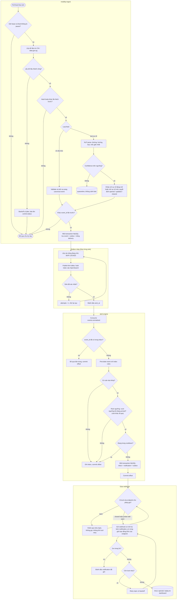
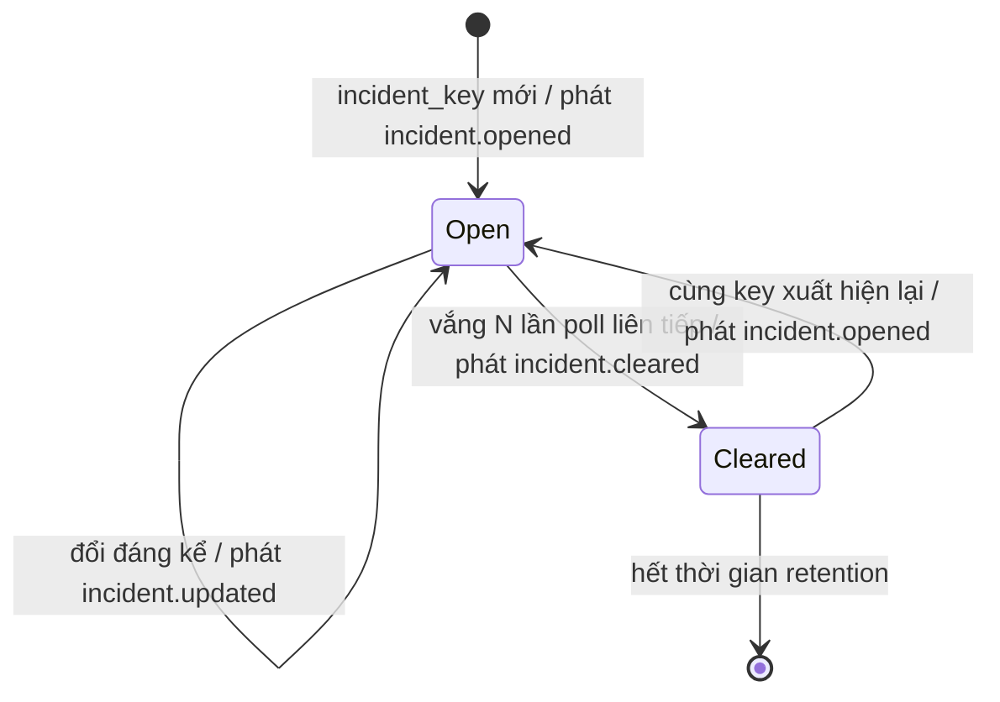
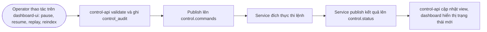
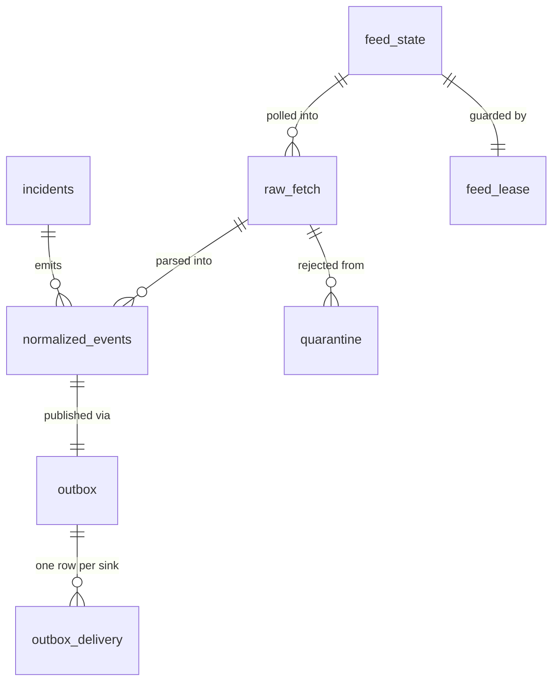
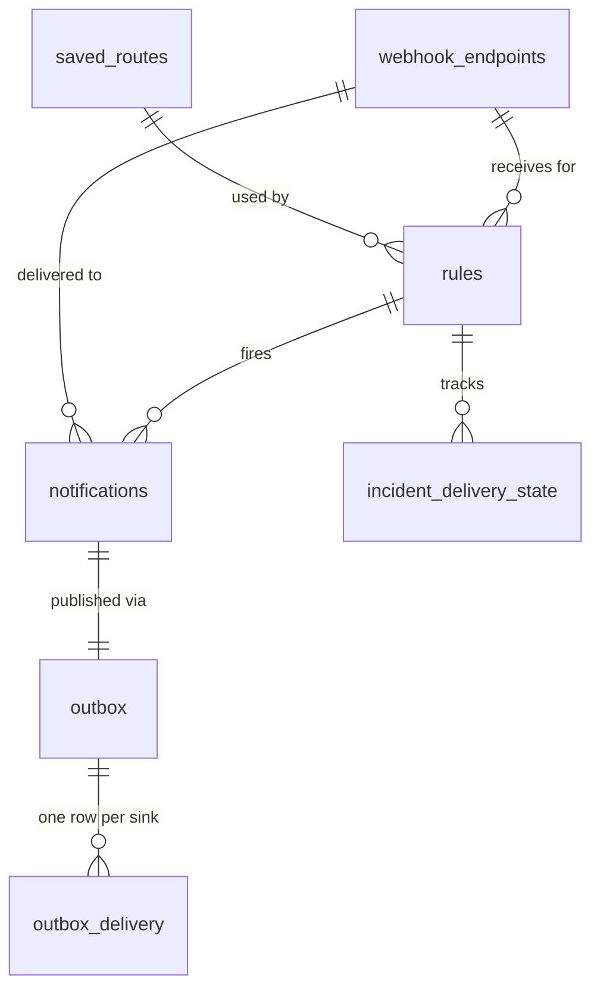
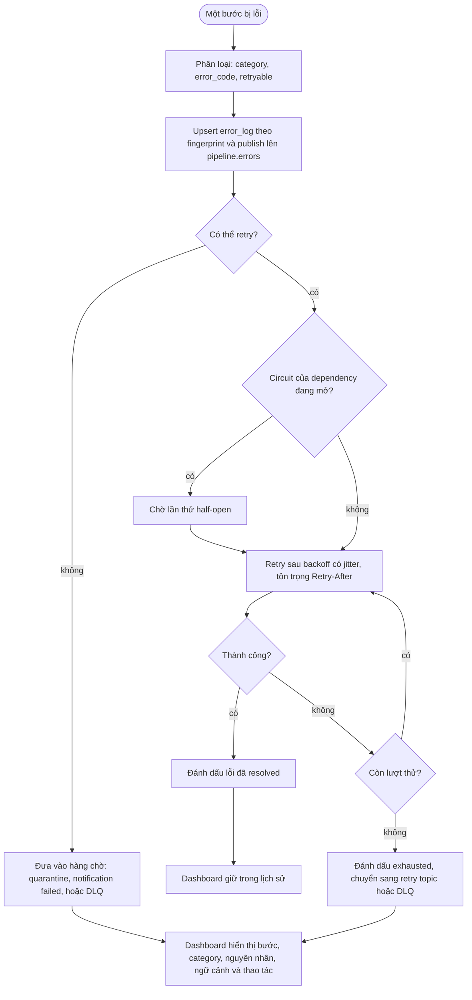

# Motorist Mobility Pipeline — Tài liệu thiết kế (Spec)

Ngày: 2026-11-04
Trạng thái: Bản nháp, chờ review
Tech stack: Python, Kafka, MySQL, Redis, OpenSearch, React
Mục tiêu: prototype thực tế để đề xuất cho Motorist (motorist.sg)
Bản tiếng Anh (bản gốc): `2026-11-04-motorist-mobility-pipeline-design.md`

## 1. Mục đích

Motorist là super app cho chủ xe tại Singapore (khoảng 2 triệu người dùng, 3.400 đối tác). Sản phẩm công khai
của họ có camera giao thông, bãi đỗ xe, cảnh báo ERP 2.0, kết quả COE, giá xăng và nhắc nhở theo xe.
Họ không công bố API dữ liệu công khai, và các cảnh báo hiện tại trông giống nhắc hạn đơn giản.

Dự án này là một data pipeline backend biến các nguồn dữ liệu giao thông công khai thành **cảnh báo
real-time, cá nhân hóa, theo vị trí địa lý**, với đặc tính của một hệ thống dữ liệu production:
high availability, fault tolerance, scalability và không mất dữ liệu.

### Tiêu chí thành công
- Không có event nào đã được `mobility-ingest` chấp nhận bị mất, kể cả khi một thành phần crash
  hoặc Kafka/OpenSearch ngừng hoạt động.
- Việc giao trùng (duplicate) không bao giờ gây ra thông báo trùng cho người dùng.
- Có thể pause, resume và replay bất kỳ service nào từ dashboard.
- Mọi OpenSearch index đều rebuild được từ MySQL/Kafka mà không mất dữ liệu.
- Lỗi một broker, một instance service hoặc một node OpenSearch không làm dừng pipeline.

### Ngoài phạm vi
- Không có mobile app cho người dùng cuối. Thông báo gửi bằng webhook có chữ ký, các kênh khác nằm ngoài phạm vi.
- Không có thanh toán, listing hay định giá xe (có thể là domain sau này).
- Không tuyên bố exactly-once. Đảm bảo là at-least-once cộng với hiệu ứng idempotent.

### 1.1 Pain points tập trung giải quyết

Các pain point này được **suy ra từ sản phẩm công khai của Motorist và đặc thù dữ liệu**, không phải thông tin
nội bộ. Đây là giả thuyết cần xác nhận với Motorist trước khi pitch. Chúng tôi chủ ý chỉ giải quyết hai vấn đề.

| # | Pain point | Vì sao đau | Cách các service xử lý | Mục |
|---|---|---|---|---|
| 1 | **Cảnh báo chung chung, thiếu ngữ cảnh.** Nhắc nhở chủ yếu là ngày hết hạn (thuế đường, bảo hiểm). Các sự kiện nhạy theo thời gian và vị trí (bãi đỗ gần tôi sắp đầy, ERP tăng giá trên tuyến của tôi, kết quả COE) chưa được biến thành cảnh báo cá nhân. | Ít liên quan, tương tác thấp. Người dùng không nhận gì đúng lúc cần. | `alert-engine` lưu rule của từng user (geo-fence, ngưỡng, cooldown) và khớp mọi event đến với toàn bộ rule trong một lần gọi OpenSearch percolator. Cooldown chống spam. | mục 4, mục 5 |
| 2 | **Sự cố giao thông là text thô nên không thể thành cảnh báo theo tuyến của người dùng.** Thông báo sự cố của LTA là câu text ngắn (đường, hướng, nguyên nhân nằm lẫn trong một câu), và cùng một sự cố xuất hiện lại qua nhiều lần cập nhật. Gửi nguyên văn thì cảnh báo không nói gì về tuyến của người dùng và bị lặp. | Cảnh báo không liên quan hoặc lặp sẽ bị bỏ qua hoặc tắt, làm phí luôn giá trị của pain point 1. | `mobility-ingest` chạy bước NLP trên text sự cố: trích xuất đường, hướng, loại sự cố, mốc gần nhất; gộp các báo cáo lặp thành một sự cố có vòng đời (mở, cập nhật, đã xử lý); rồi phát event có cấu trúc. `alert-engine` khớp event đó với tuyến đã lưu hoặc geo-fence của user và chỉ cảnh báo khi có thay đổi thật. | mục 3.1, mục 4 |

Scalability, high availability và dashboard là các đặc tính kỹ thuật hỗ trợ hai pain point này, không phải
các vấn đề riêng mà chúng tôi tuyên bố giải quyết.

## 2. High-Level Design (Thiết kế tổng quan)

### 2.1 Bối cảnh hệ thống

```
 NGUỒN NGOÀI                   HỆ THỐNG NÀY                        NGƯỜI NHẬN
 ----------------      -----------------------------      ---------------------------
 LTA DataMall   --\                                    /-- App Motorist / hệ thống đối tác
 data.gov.sg    ---+-->  Mobility Event Pipeline  ----+---  (cảnh báo qua webhook)
 (carpark, ERP,    |     (2 microservice + platform)   \-- Operator (Dashboard UI)
  sự cố, giá xăng, |
  COE)         ----/
```

Đầu vào là **pull** (polling API bên ngoài). Đầu ra là **push** (webhook thông báo), cộng thêm
dashboard cho operator. Tích hợp với Motorist hiện bằng webhook, sau này có thể là Kafka topic hoặc REST API.

### 2.2 Các tầng logic

| Tầng | Trách nhiệm | Thành phần |
|---|---|---|
| Acquisition | Lấy và validate dữ liệu ngoài | `mobility-ingest` (feed adapter, normalizer) |
| Transport | Event log bền vững, có thứ tự, replay được | Kafka topics, outbox relay |
| Processing | Khớp event với nhu cầu người dùng, đảm bảo idempotency | `alert-engine` (inbox, percolator, cooldown) |
| Storage | System of record và các projection | MySQL (nguồn sự thật), OpenSearch (search/match), Redis (tạm) |
| Delivery | Gửi thông báo tin cậy | Webhook sender, retry topic, DLQ |
| Control và observability | Vận hành và giám sát | `control-api`, `dashboard-ui`, topic `control.*` |

### 2.3 Luồng dữ liệu end-to-end

1. `mobility-ingest` poll một feed rồi normalize response.
2. Commit `normalized_events` + `outbox` trong **một** transaction MySQL.
3. Relay publish lên Kafka (`events.normalized`) và index vào OpenSearch (`events-*`).
4. `alert-engine` consume event, ghi vào inbox, rồi percolate với index `rules`.
5. Mỗi rule khớp tạo một dòng notification và một dòng outbox, trong một transaction.
6. Relay publish `notifications.requested`. Webhook sender gửi, retry rồi tới DLQ nếu lỗi.
7. Mỗi bước phát heartbeat và metrics lên `control.status` cho dashboard.

### 2.4 Kafka topics

| Topic | Producer | Consumer | Key | Partitions / retention |
|---|---|---|---|---|
| `events.normalized` | mobility-ingest | alert-engine | entity_id | 12 / 7 ngày |
| `events.normalized.retry` / `.dlq` | alert-engine | alert-engine / operator | entity_id | 12 / 14 ngày |
| `notifications.requested` | alert-engine | webhook sender | user_id | 12 / 7 ngày |
| `notifications.retry` / `.dlq` | sender | sender / operator | user_id | 12 / 14 ngày |
| `control.commands` | control-api | mọi service | service id đích | 1 / compacted |
| `control.status` | mọi service | control-api | instance id | 3 / 1 ngày |
| `pipeline.errors` | mọi service (qua outbox) | control-api | service + fingerprint | 3 / 14 ngày |

Số partition là đơn vị scale ngang: consumer trong một group scale tối đa bằng số partition.
Key theo `entity_id` / `user_id` giữ thứ tự theo từng thực thể.

### 2.5 Triển khai và high availability

```
  Giao cả docker-compose (local/demo) và Kubernetes manifests (pitch/giống production)

  +------------------+  +------------------+   +-----------------------------+
  | mobility-ingest  |  | alert-engine     |   | control-api + dashboard-ui  |
  | x2 (1 leader mỗi |  | xN (consumer     |   | x2 sau load balancer        |
  |  feed qua lock)  |  |  group)          |   +-----------------------------+
  +--------+---------+  +---------+--------+
           |                      |
  +--------v----------------------v------------------------------------------+
  | Kafka x3 (RF=3, min ISR=2) | MySQL primary+replica mỗi schema |            |
  | OpenSearch x3 (1 replica)  | Redis (primary+replica, Sentinel) |           |
  +--------------------------------------------------------------------------+
```

| Mối lo | Cơ chế |
|---|---|
| Single point of failure ở poller | Hai instance `mobility-ingest`; lease theo feed (Redis lock kèm fencing token ở MySQL) chọn một poller active. Instance còn lại tiếp quản khi lease hết hạn. |
| Scale và failover consumer | Consumer-group rebalance. Thêm instance tới bằng số partition. |
| Mất broker | RF=3 và `min.insync.replicas=2`; producer dùng `acks=all`. |
| Mất database | Promote replica. Outbox row vẫn còn nên relay chạy tiếp. |
| Mất node OpenSearch | Replica shard được promote. Index rebuild được từ MySQL/Kafka nếu cần. |
| Mất Redis | Dedupe và cooldown quay về unique key của MySQL. Vẫn đúng, chỉ tăng tải DB. |

### 2.6 Các quyết định kiến trúc chính

| Quyết định | Lý do | Đánh đổi chấp nhận |
|---|---|---|
| Microservice hướng sự kiện trên Kafka | Tách rời, replay, scale độc lập | Eventual consistency, vận hành nặng hơn |
| Transactional outbox (không dual write) | Lưu và publish nguyên tử, không mất | Thêm bảng, có thể giao trùng |
| Consumer idempotent (inbox, unique key) | Làm at-least-once an toàn | Thêm một lần ghi mỗi event |
| MySQL là truth, OpenSearch là projection | Rebuild được, không bị khóa vào search | Index trễ khoảng 1s so với truth |
| Percolator để khớp rule | Một lần gọi khớp event với mọi rule và geo-fence | Rule đổi chỉ có hiệu lực sau refresh |
| Control plane qua Kafka, không gọi trực tiếp | Service tách rời, command replay được | Command bất đồng bộ |
| Poll nguồn ngoài, không push | Nguồn công khai không có push | Độ tươi bị giới hạn bởi chu kỳ poll |
| Circuit breaker và bulkhead theo từng endpoint khi giao webhook (mục 4.2) | Một bên nhận chậm hoặc chết không được làm kẹt việc giao cho các bên còn lại | Thêm trạng thái theo từng endpoint; cảnh báo cho endpoint hỏng đến trễ khi nó phục hồi |
| Hysteresis (ngưỡng kích hoạt và ngưỡng re-arm riêng) cho rule dạng ngưỡng (mục 4.1) | Giá trị dao động quanh ngưỡng không được báo lặp | Thêm một giá trị phải cấu hình; rule khớp nhiều event ứng viên hơn |
| Event contract có version, chỉ thay đổi theo hướng cộng thêm (mục 3.2) | Các service deploy độc lập và event là điểm ghép nối duy nhất | Cần contract test trong CI; thay đổi phá vỡ cần một release hỗ trợ cả hai version |
| Parser sự cố sau một interface Strategy (mục 3.1) | Thêm hoặc thay parser, kể cả LLM sau này, mà không đụng pipeline | Thêm một lớp gián tiếp; mỗi parser phải báo confidence |

### 2.7 Chi tiết thành phần và luồng dữ liệu

Hai domain microservice, mỗi service một nhiệm vụ, có MySQL schema riêng, chỉ giao tiếp qua Kafka.
Không dùng chung database, không join chéo service.

```
LTA DataMall / data.gov.sg
        |
  [mobility-ingest] --MySQL tx--> events + outbox
        |  relay (thread trong service)
        |--> Kafka  events.normalized  ------------------+
        '--> OpenSearch  events-*  (_id idempotent)      |
                                                         v
                                                 [alert-engine]
                              inbox -> percolate rules -> notifications + outbox
                                        |--> OpenSearch  rules (percolator), notifications-*
                                        '--> Kafka  notifications.requested -> webhook sender
Dashboard (công cụ admin): control-api (FastAPI) + dashboard-ui (React)
        control.commands (Kafka, compacted)  ->  service thực thi
        control.status   (Kafka)             <-  heartbeat/metrics từ service
```

Dashboard (`control-api` + `dashboard-ui`) là công cụ admin, không tính là domain microservice. Nó không bao giờ gọi trực tiếp service nghiệp vụ.

### 2.8 Activity diagrams

**A. Luồng end-to-end (từ poll đến webhook).** Các swimlane là các subgraph. Các nhánh lỗi được vẽ rõ
vì đó là nơi các đảm bảo giao nhận được thực hiện.



**B. Vòng đời sự cố.** Báo cáo lặp y hệt không thay đổi gì, nhờ vậy cùng một sự cố không sinh cảnh báo lặp.



**C. Luồng điều khiển của operator.**



### 2.9 Design pattern được áp dụng

| Pattern | Dùng ở đâu | Vấn đề giải quyết |
|---|---|---|
| Transactional outbox | Lưu + dòng outbox trong một transaction MySQL (mục 3, 6) | Không bao giờ mất lần publish giữa lúc lưu và Kafka |
| Inbox / idempotent consumer | `inbox`, `UNIQUE (rule_id, event_id)` (mục 4, 5.1) | Giao at-least-once vẫn chỉ cho ra một hiệu ứng |
| Competing consumers | Consumer group key theo `entity_id` / `user_id` (mục 2.4) | Scale ngang và giữ thứ tự theo thực thể |
| Leader election kèm fencing token | `feed_lease` (mục 2.5, 5.1) | Chỉ một poller active; instance cũ không ghi được |
| Retry topic và DLQ | Consumer và sender | Poison message không chặn partition |
| Projection (CQRS-lite) | MySQL là truth, OpenSearch rebuild được (mục 2.6, 5) | Search không bao giờ là rủi ro mất dữ liệu |
| Reverse search | OpenSearch percolator (mục 4, 5) | Một lần gọi khớp event với mọi rule |
| Adapter và anti-corruption layer | Feed adapter và normalizer (mục 3, 8) | Định dạng upstream lộn xộn không lọt vào domain |
| State machine | Vòng đời sự cố (diagram B, mục 3.1) | Báo cáo lặp không sinh cảnh báo lặp |
| Tách control plane | Các topic `control.*` (mục 7) | Điều khiển service mà không gọi trực tiếp |
| Circuit breaker và bulkhead | Giao webhook (mục 4.2) | Một bên nhận hoặc dependency hỏng không làm kẹt phần còn lại |
| Hysteresis | Rule dạng ngưỡng (mục 4.1) | Không báo chập chờn quanh ngưỡng |
| Strategy / chain of responsibility | Parser sự cố (mục 3.1) | Thay hoặc thêm parser một cách an toàn |
| Contract có version, tolerant reader | Envelope của event (mục 3.2) | Deploy độc lập không làm gãy nhau |
| Conditional fetch (phát hiện thay đổi) | Hash body trước khi parse (mục 3) | Bỏ qua việc không cần khi feed không đổi |

**Chủ ý không dùng**

| Pattern | Lý do không dùng |
|---|---|
| Event sourcing đầy đủ | `normalized_events` cộng republish đã cho replay, không cần snapshot và upcasting event |
| Saga hoặc two-phase commit | Pipeline một chiều, không có giao dịch xuyên service cần rollback |
| Kafka exactly-once transactions | At-least-once cộng hiệu ứng idempotent đơn giản hơn và đủ dùng |
| CDC (ví dụ Debezium) thay cho relay | Cần vận hành Kafka Connect; xem xét lại khi lên production |
| Thêm microservice | Hai service khớp với hai domain; thêm chỉ tăng chi phí vận hành |

### Platform (hạ tầng dùng chung, không phải service)
- Kafka: 3 broker, replication factor 3, `min.insync.replicas=2`, producer `acks=all` bật idempotence.
- MySQL: primary + replica cho mỗi schema.
- Redis: cửa sổ dedupe, cache nóng, rate limit. Không bao giờ là nguồn sự thật.
- OpenSearch: 3 node, 1 replica shard, chính sách retention ISM.

Mục tiêu phi chức năng (ban đầu, sẽ kiểm chứng bằng load test ở mục 9):
- Độ tươi: từ lúc phát hiện cập nhật feed tới lúc có notification dưới 10s ở p95.
- Throughput: 2.000 events/s liên tục qua Kafka trên cluster demo.
- Availability: pipeline không dừng khi mất một broker, một instance hoặc một node OpenSearch.
- Durability: không mất bất kỳ event nào đã được xác nhận.

## 3. Microservice 1: `mobility-ingest`

**Nhiệm vụ duy nhất:** lấy dữ liệu giao thông bên ngoài, normalize, và publish event chuẩn một cách tin cậy.

### Luồng xử lý
1. Scheduler poll từng feed (carpark, ERP, sự cố, giá xăng, COE). Mỗi feed có chu kỳ, backoff và cursor riêng.
2. Conditional fetch: so SHA-256 của body response với `raw_fetch.payload_hash` đã lưu lần trước của feed.
   Body giống hệt thì bỏ qua parse và lưu, không tạo dòng `raw_fetch` mới, chỉ cập nhật
   `feed_state.last_success_at`. Sự cố đang mở vẫn có mặt trong body giống hệt nên không bị tính là vắng mặt.
3. Normalizer validate payload theo canonical schema và gán `event_id` xác định (hash của các trường định
   danh trong event contract, mục 3.2), nên poll lặp dữ liệu không đổi sẽ ra cùng id. Mọi event đều mang
   `schema_version`.
4. Một transaction MySQL ghi `normalized_events` và `outbox`. Dữ liệu không đổi sẽ đụng unique key của
   `event_id` và bị bỏ qua, không phát event mới.
5. Relay thread giao từng dòng outbox tới các sink (Kafka và OpenSearch) và ghi trạng thái giao theo từng sink.

### MySQL (schema `ingest`)
```sql
CREATE TABLE feed_state (
  feed VARCHAR(64) PRIMARY KEY,
  cursor_value VARCHAR(255) NULL,
  last_polled_at TIMESTAMP(3) NULL,
  paused BOOLEAN NOT NULL DEFAULT FALSE
);

CREATE TABLE normalized_events (
  event_id CHAR(64) PRIMARY KEY,
  feed VARCHAR(64) NOT NULL,
  entity_id VARCHAR(128) NOT NULL,
  observed_at TIMESTAMP(3) NOT NULL,
  lat DECIMAL(9,6) NULL,
  lon DECIMAL(9,6) NULL,
  payload JSON NOT NULL,
  KEY idx_feed_time (feed, observed_at)
);

CREATE TABLE outbox (
  id BIGINT AUTO_INCREMENT PRIMARY KEY,
  event_id CHAR(64) NOT NULL UNIQUE,
  topic VARCHAR(100) NOT NULL,
  partition_key VARCHAR(128) NOT NULL,
  payload JSON NOT NULL,
  created_at TIMESTAMP(3) DEFAULT CURRENT_TIMESTAMP(3)
);

CREATE TABLE outbox_delivery (
  outbox_id BIGINT NOT NULL,
  sink VARCHAR(32) NOT NULL,        -- 'kafka' | 'opensearch'
  sent_at TIMESTAMP(3) NULL,
  attempts INT NOT NULL DEFAULT 0,
  PRIMARY KEY (outbox_id, sink),
  KEY idx_pending (sink, sent_at, outbox_id)
);
```
Các dòng delivery được tạo cùng transaction với dòng outbox, mỗi sink được cấu hình một dòng.

### Quy tắc của relay
- Với mỗi sink, chọn các dòng đang chờ bằng `ORDER BY outbox_id LIMIT N FOR UPDATE SKIP LOCKED`, nhờ đó
  chạy nhiều instance cho HA mà không làm trùng việc.
- Sink Kafka: publish với `acks=all`, dùng `partition_key` (ví dụ id bãi đỗ) để giữ thứ tự theo entity.
- Sink OpenSearch: bulk index với `_id = event_id` vào `events-YYYY.MM.DD`. Replay chỉ ghi đè document cũ, không tạo trùng.
- Chỉ đánh dấu `sent_at` sau khi sink xác nhận. Crash giữa lúc publish và đánh dấu sẽ publish lại, consumer chịu được.
- Sink ngừng chỉ làm backlog của sink đó tăng. Các sink khác và poller vẫn chạy.
- Dòng cũ hơn thời gian retention (3 ngày) và đã gửi hết các sink sẽ bị xóa.

### Hành vi khi lỗi
Lỗi API upstream dùng exponential backoff có jitter và hiển thị trên dashboard. Payload sai schema được ghi
vào bảng `quarantine` để kiểm tra, không bao giờ bị bỏ im lặng.

### 3.1 Xử lý text sự cố (NLP)

Các feed có cấu trúc (bãi đỗ, ERP, COE, giá xăng) chỉ cần validate và ánh xạ.
**Sự cố giao thông thì khác: nội dung là text tự do**, nên service này thêm một bước trích xuất.

1. **Parse.** Việc parse nằm sau một interface, `IncidentParser.parse(text, context)`, trả về các trường
   (đường, hướng, loại sự cố, mốc gần nhất), confidence và `parser_id`. Các parser chạy thành một chuỗi có
   thứ tự: kết quả đầu tiên đạt ngưỡng confidence sẽ thắng, nếu không parser nào đạt thì kết quả tốt nhất
   vào `quarantine`. Phiên bản đầu có hai parser: parser theo mẫu (regex trên các mẫu câu của thông báo) và
   parser dùng gazetteer (tên đường, expressway, từ viết tắt), chạy khi parser theo mẫu chưa đủ tự tin. Parser
   LLM nằm ngoài phạm vi phiên bản này, nhưng có thể thêm làm một mắt xích nữa trong chuỗi, bật bằng feature
   flag, mà không sửa phần còn lại của pipeline. Mỗi kết quả lưu `parser_id` nên đo được độ chính xác theo
   từng parser. Cách diễn đạt và định dạng của thông báo **chưa được xác minh với dữ liệu thật**. Việc viết
   quy tắc bắt đầu từ một mẫu thông báo thật thu thập được, không dựa trên suy đoán.
2. **Định vị.** Kết hợp tên đường đã parse với tọa độ trong feed để tạo `geo_point` và id đoạn đường,
   giúp event khớp được với tuyến.
3. **Khớp sự cố.** Một sự cố thật phải có đúng một `incident_key` trong suốt vòng đời. Key là UUID
   **được gán một lần khi thấy sự cố lần đầu, và không bao giờ tính lại từ nội dung text**. Mỗi báo cáo mới
   được khớp với các sự cố đang mở thay vì băm theo cách diễn đạt: cùng đường và hướng đã chuẩn hóa, loại
   sự cố tương thích, và nằm trong bán kính khoảng cách quanh vị trí của sự cố đang mở. Khớp được thì dùng
   lại key của sự cố đó; không khớp thì mở sự cố mới với key mới. Nếu có nhiều ứng viên thì chọn cái gần
   nhất trên cùng đường. Việc khớp chạy ngay trong transaction lưu, với các dòng ứng viên bị khóa, nên hai
   bên ghi không thể tạo hai key cho một sự cố. Nếu feed hóa ra có mã định danh sự cố ổn định (cần xác minh
   trên dữ liệu thật) thì dùng mã đó trực tiếp và việc khớp chỉ là phương án dự phòng. Operator có thể gộp hai
   sự cố hoặc tách một sự cố trên dashboard để sửa lần khớp sai.
4. **Vòng đời.** Phát `incident.opened` cho key mới, `incident.updated` chỉ khi một trường quan trọng
   đổi, và `incident.cleared` khi key vắng mặt N lần poll liên tiếp. Báo cáo lặp y hệt thì không phát gì.
5. **Độ tin cậy.** Mỗi lần parse có điểm confidence. Thông báo không parse được trên ngưỡng sẽ vào
   `quarantine` và **không gửi cảnh báo**, nên parse sai không bao giờ sinh cảnh báo giả.

```sql
CREATE TABLE incidents (
  incident_key CHAR(36) PRIMARY KEY,   -- UUID gán một lần khi thấy lần đầu, không tính lại
  status ENUM('open','cleared') NOT NULL,
  incident_type VARCHAR(64) NOT NULL,
  road VARCHAR(128) NOT NULL,
  direction VARCHAR(64) NULL,
  landmark VARCHAR(255) NULL,
  lat DECIMAL(9,6) NULL,
  lon DECIMAL(9,6) NULL,
  parse_confidence DECIMAL(3,2) NOT NULL,
  raw_text TEXT NOT NULL,
  first_seen_at TIMESTAMP(3) NOT NULL,
  last_seen_at TIMESTAMP(3) NOT NULL,
  missed_polls INT NOT NULL DEFAULT 0,
  merged_into CHAR(36) NULL            -- được gán khi operator gộp các sự cố trùng
);
```
Chất lượng được đo trên một mẫu gán nhãn thủ công: độ chính xác trích xuất theo từng trường và tỷ lệ
cảnh báo giả. Phân tích ảnh camera nằm ngoài phạm vi của phiên bản này.

### 3.2 Event contract và versioning

Hai service deploy độc lập và chỉ chia sẻ event Kafka, nên event là điểm ghép nối duy nhất và phải tiến
hóa an toàn.

- **Envelope.** Mọi event mang `event_id`, `schema_version` (số nguyên), `type`, `feed`, `entity_id`,
  `observed_at`, `trace_id` và `payload`. `schema_version` cũng được đặt vào Kafka header để consumer quyết
  định trước khi parse body.
- **Contract.** Schema của event là các file JSON Schema trong repo (`contracts/events/`) và liệt kê các
  *trường định danh* tạo nên hash `event_id`. Thêm một trường tùy chọn không làm đổi id nào.
- **Thay đổi tương thích (không tăng version).** Thêm trường tùy chọn. Consumer là tolerant reader: bỏ qua
  trường chưa biết.
- **Thay đổi phá vỡ (tăng version).** Xóa hoặc đổi tên trường, đổi kiểu hoặc ý nghĩa, hoặc biến một trường
  thành bắt buộc. Thứ tự rollout: consumer học version N+1 trước trong khi producer còn phát N, rồi producer
  chuyển sang, rồi bỏ hỗ trợ N ở release sau. Producer chỉ phát một version tại một thời điểm (không dual
  publish vì sẽ tạo bản trùng).
- **Version không hỗ trợ.** Consumer nhận version cao hơn mức hỗ trợ không retry như poison message. Nó đi
  thẳng vào DLQ với lý do `unsupported_schema` và được replay sau khi consumer nâng cấp.
- **CI.** Contract test validate các event mẫu của producer theo schema của consumer và làm fail build khi
  có thay đổi không tương thích.

## 4. Microservice 2: `alert-engine`

**Nhiệm vụ duy nhất:** quyết định ai cần được báo về event nào, và giao thông báo đó đúng một lần.

### Luồng xử lý
1. Consume `events.normalized` (consumer group, commit offset thủ công sau khi transaction DB commit).
2. Trong một transaction MySQL: chèn `event_id` vào `inbox` (unique key từ chối trùng), khớp event với
   rule, ghi `notifications` và `outbox`.
3. Việc khớp dùng **percolator** của OpenSearch: rule cảnh báo được lưu dưới dạng query trong index
   `rules`, và mỗi event đến được percolate để tìm mọi rule khớp chỉ trong một lần gọi.
4. Relay publish `notifications.requested` lên Kafka và index vào `notifications-*`.
5. Webhook sender gửi, retry, rồi tới retry topic và DLQ. `notification_id` là idempotency key gửi cho receiver.

### Mô hình rule
Một rule thuộc về một user và gồm: loại feed, geo-fence tùy chọn (hình tròn hoặc polygon) hoặc tuyến đã lưu (lưu dạng polygon hành lang quanh các đoạn đường user hay đi), bộ lọc sự cố tùy chọn (loại, mức nghiêm trọng tối thiểu), ngưỡng tùy chọn
(ví dụ số chỗ trống dưới N, giá ERP trên X, kèm giá trị re-arm tùy chọn, mục 4.1), cooldown (giây), webhook đích.
MySQL là system of record của rule. Ghi rule đi qua outbox vào percolator index `rules`, nên index
rebuild được từ MySQL.

### MySQL (schema `alerts`)
```sql
CREATE TABLE rules (
  rule_id CHAR(36) PRIMARY KEY,
  user_id VARCHAR(64) NOT NULL,
  definition JSON NOT NULL,
  cooldown_seconds INT NOT NULL DEFAULT 900,
  enabled BOOLEAN NOT NULL DEFAULT TRUE,
  version BIGINT NOT NULL DEFAULT 1,
  KEY idx_user (user_id)
);

CREATE TABLE inbox (
  event_id CHAR(64) PRIMARY KEY,
  processed_at TIMESTAMP(3) DEFAULT CURRENT_TIMESTAMP(3)
);

CREATE TABLE notifications (
  notification_id CHAR(36) PRIMARY KEY,
  rule_id CHAR(36) NOT NULL,
  event_id CHAR(64) NOT NULL,
  user_id VARCHAR(64) NOT NULL,
  status ENUM('pending','sent','failed') NOT NULL DEFAULT 'pending',
  UNIQUE KEY uq_rule_event (rule_id, event_id)
);

CREATE TABLE outbox (...);           -- cùng cấu trúc với mobility-ingest
CREATE TABLE outbox_delivery (...);  -- cùng cấu trúc, sink: 'kafka' | 'opensearch'
```
`UNIQUE (rule_id, event_id)` đảm bảo một rule chỉ kích hoạt tối đa một lần cho mỗi event, kể cả khi replay.
Redis giữ key cooldown theo rule (`SET NX EX`) làm lớp chặn nhanh. MySQL vẫn là nguồn quyết định.

### 4.1 Rule dạng ngưỡng với hysteresis

Rule báo "số chỗ dưới 20" sẽ bắn ở mỗi lần cập nhật khi bãi đỗ dao động quanh 19 đến 21. Cooldown chỉ làm
chậm điều đó chứ không xóa nguyên nhân. Vì vậy rule dạng ngưỡng mang hai giá trị:

```json
{"field": "available_lots", "op": "lt", "trigger": 20, "rearm": 30}
```

- `trigger` là giá trị kích hoạt cảnh báo. `rearm` nằm ở phía bên kia (với `lt` thì `rearm` lớn hơn
  `trigger`; với `gt` thì nhỏ hơn) và là giá trị mà số đọc phải vượt qua thì rule mới được bắn lại. Bước
  validate rule từ chối `rearm` nằm sai phía. Không có `rearm` thì rule không có hysteresis và hành xử như
  trước.
- Trạng thái lưu theo từng cặp (rule, entity) trong `rule_threshold_state`, vì một rule geo-fence có thể phủ
  nhiều bãi đỗ. Đang armed và số đọc vượt `trigger`: bắn, rồi chuyển sang disarmed. Đang disarmed và số đọc
  vượt `rearm`: armed lại, không có thông báo. Giữa hai giá trị thì không có gì xảy ra.
- Thứ tự kiểm tra: percolate, rồi hysteresis, rồi cooldown, rồi ghi notification. Lần vượt ngưỡng được tính
  là đã dùng kể cả khi cooldown chặn cảnh báo. Nếu không, rule sẽ bắn ngay khi hết cooldown dù bãi đỗ chưa
  hề hồi phục.
- Thay đổi trạng thái được commit trong cùng transaction với dòng inbox và notification, nên replay không
  thể lật trạng thái hai lần (inbox loại event đó).
- Tài liệu percolator của rule có hysteresis khớp theo `trigger` HOẶC `rearm`, để event re-arm tới được
  engine và engine phân loại event. Cái giá: nhiều ứng viên khớp hơn cho các bãi đỗ đó, nhưng chỉ ghi một
  dòng khi trạng thái đổi.
- Tính đúng đắn dựa vào thứ tự theo từng entity, vốn do partition key `entity_id` đảm bảo.
- Hysteresis chỉ áp dụng cho rule dạng ngưỡng. Rule sự cố dùng vòng đời sự cố.

### 4.2 Cô lập việc giao webhook

Bên nhận là hệ thống của bên thứ ba. Một endpoint chậm (timeout 5s) chiếm worker của sender, và vì message
được key theo `user_id` nên nhiều endpoint dùng chung một partition, một bên nhận xấu sẽ làm chậm các bên
khỏe (head-of-line blocking). Việc giao được cô lập theo từng endpoint:

1. **Circuit breaker.** Các trạng thái: `closed`, `open`, `half_open`. Circuit mở sau 5 lần lỗi liên tiếp
   (timeout, lỗi kết nối hoặc 5xx). Nó giữ mở 60 giây, gấp đôi sau mỗi lần probe thất bại, tối đa 30 phút.
   Hết thời gian chờ thì circuit sang `half_open` và cho đúng một request probe (bảo vệ bằng `SET NX` trên
   `probe:{endpoint_id}`). Thành công thì đóng và đặt lại thời gian chờ; thất bại thì mở lại với thời gian
   chờ gấp đôi. 4xx vĩnh viễn (case F35) và 429 không tính vào breaker: 4xx đi theo đường riêng, 429 tuân
   theo `Retry-After`.
2. **Hoãn, không chặn.** Khi circuit đang mở, sender không gọi endpoint. Nó đưa notification vào lại
   `notifications.retry` với độ trễ bằng thời gian mở còn lại, và lần hoãn này không tốn lượt retry.
   Notification chưa giao được sau TTL (24 giờ) sẽ thành `failed` và vào DLQ. Partition vẫn chạy.
3. **Bulkhead.** Mỗi endpoint có tối đa 4 request đang xử lý trên mỗi instance sender (một semaphore đặt
   trên worker pool của instance). Việc của endpoint vượt giới hạn được hoãn theo cách tương tự thay vì chờ
   worker, nên một endpoint chậm chỉ giữ được tối đa phần worker của chính nó.
4. **Trạng thái.** `webhook_endpoints.circuit_state`, `circuit_open_until` và `circuit_open_count` là nguồn
   quyết định. Redis `circuit:{endpoint_id}` là bản sao nóng, mất Redis thì quay về MySQL.
   `webhook_endpoints.status` thành `failing` khi circuit đang mở; `disabled` chỉ do operator hoặc 410 vĩnh
   viễn đặt.
5. **Vận hành.** Dashboard liệt kê các circuit đang mở và số notification bị hoãn. Operator có thể ép mở hoặc
   đóng circuit bằng lệnh điều khiển `endpoint.circuit`, có ghi audit.

## 5. Thiết kế OpenSearch (tùy biến)

| Index | Mục đích | Mapping chính |
|---|---|---|
| `events-YYYY.MM.DD` | Lịch sử event để tìm kiếm trên dashboard | `geo_point location`, `keyword feed/entity_id`, `date observed_at`, `payload` dynamic tắt trừ các field đã map |
| `rules` | Kho rule dạng percolator | field `percolator query` cùng các field phản chiếu (`geo_point`/`geo_shape`, ngưỡng số) |
| `notifications-YYYY.MM` | Audit giao thông báo và truy vấn dashboard | `keyword status/user_id`, `date created_at` |

- **Analyzer tên đường:** analyzer tùy biến (lowercase, ASCII folding, synonym cho tên đường viết tắt)
  trên `road`/`landmark`, để tìm kiếm và khớp rule chịu được các biến thể chính tả.
- **Index template** tùy biến và mapping tường minh, `dynamic: strict` cho các index lõi.
- **Chính sách ISM:** events hot 7 ngày, xóa sau 30 ngày. Notifications roll theo tháng.
- OpenSearch chỉ là projection. Có thể xóa và rebuild bằng cách replay lịch sử outbox MySQL hoặc retention của Kafka.
- Percolation là near-real-time. Thay đổi rule hiển thị sau khi index refresh (khoảng 1s).

## 5.1 Thiết kế database

Mục này là **thiết kế database chính thức**. Các đoạn SQL trong mục 3 và 4 chỉ để minh họa và được thay bằng
mục này (ví dụ `normalized_events` có khóa chính ghép và `incidents.incident_key` là UUID).

### Nguyên tắc
- **Mỗi microservice một schema** (`ingest`, `alerts`, `control`), chỉ service đó sở hữu. Không join chéo
  schema và không foreign key chéo schema. Các service chỉ chia sẻ dữ liệu qua event Kafka.
- MySQL 8, InnoDB, `utf8mb4`. Mọi thời gian là UTC `DATETIME(3)`.
- Quan hệ trong cùng một schema là **quan hệ logic** (xem bên dưới). Không ép foreign key trên bảng
  partition hoặc bảng ghi nhiều, vì MySQL không hỗ trợ và chúng làm chậm relay.
- Id: `event_id` là chuỗi hex SHA-256 xác định (idempotency key); id thực thể là UUID gán một lần.
  Payload là cột `JSON` để các trường của feed thay đổi mà không cần migration.
- Thay đổi schema dùng Alembic, mỗi service một lịch sử migration, theo kiểu **expand rồi contract**
  (thêm cột mới, deploy code ghi cả hai, backfill, rồi mới xóa cột cũ), để các service deploy độc lập.
- Không lưu secret trong database; `webhook_endpoints.secret_ref` trỏ tới nơi lưu secret.

### Mô hình logic

**Schema `ingest`**



**Schema `alerts`**



**Schema `control`** gồm `service_status`, `control_audit` và `dlq_index`. Nó không có quan hệ nghiệp vụ;
đó là read model của những gì hai service kia báo cáo.

### Danh mục bảng (DDL đầy đủ)

```sql
-- ===================== schema: ingest (mobility-ingest) =====================
CREATE TABLE feed_state (
  feed VARCHAR(64) PRIMARY KEY,
  cursor_value VARCHAR(255) NULL,
  last_polled_at DATETIME(3) NULL,
  last_success_at DATETIME(3) NULL,
  consecutive_failures INT NOT NULL DEFAULT 0,
  paused BOOLEAN NOT NULL DEFAULT FALSE
);

CREATE TABLE feed_lease (                 -- fencing token source of truth
  feed VARCHAR(64) PRIMARY KEY,
  holder VARCHAR(64) NOT NULL,
  fencing_token BIGINT NOT NULL,          -- incremented on every acquisition
  expires_at DATETIME(3) NOT NULL
);

CREATE TABLE raw_fetch (                  -- original response, for re-parse
  id BIGINT AUTO_INCREMENT PRIMARY KEY,
  feed VARCHAR(64) NOT NULL,
  fetched_at DATETIME(3) NOT NULL,
  http_status SMALLINT NOT NULL,
  payload_hash CHAR(64) NOT NULL,         -- identical response is detected cheaply
  body MEDIUMBLOB NOT NULL,               -- compressed
  KEY idx_feed_time (feed, fetched_at),
  KEY idx_feed_hash (feed, payload_hash)
);

CREATE TABLE normalized_events (          -- partitioned by month on observed_at
  event_id CHAR(64) NOT NULL,
  feed VARCHAR(64) NOT NULL,
  entity_id VARCHAR(128) NOT NULL,        -- carpark id, or incident_key for incidents
  observed_at DATETIME(3) NOT NULL,
  lat DECIMAL(9,6) NULL,
  lon DECIMAL(9,6) NULL,
  payload JSON NOT NULL,
  raw_fetch_id BIGINT NULL,
  fencing_token BIGINT NOT NULL,
  trace_id CHAR(32) NULL,
  schema_version SMALLINT NOT NULL DEFAULT 1,
  PRIMARY KEY (event_id, observed_at),    -- partition column must be in every unique key
  KEY idx_feed_time (feed, observed_at),
  KEY idx_entity_time (entity_id, observed_at)
) PARTITION BY RANGE (TO_DAYS(observed_at)) (
  PARTITION p202611 VALUES LESS THAN (TO_DAYS('2026-12-01')),
  PARTITION pmax VALUES LESS THAN MAXVALUE
);

CREATE TABLE incidents (
  incident_key CHAR(36) PRIMARY KEY,      -- UUID assigned once at first sight
  status ENUM('open','cleared') NOT NULL,
  incident_type VARCHAR(64) NOT NULL,
  road VARCHAR(128) NOT NULL,
  direction VARCHAR(64) NULL,
  landmark VARCHAR(255) NULL,
  lat DECIMAL(9,6) NULL,
  lon DECIMAL(9,6) NULL,
  parse_confidence DECIMAL(3,2) NOT NULL,
  parser_id VARCHAR(32) NOT NULL,         -- parser nào cho kết quả được chấp nhận
  raw_text TEXT NOT NULL,
  first_seen_at DATETIME(3) NOT NULL,
  last_seen_at DATETIME(3) NOT NULL,
  missed_polls INT NOT NULL DEFAULT 0,
  sequence BIGINT NOT NULL DEFAULT 0,     -- +1 for every emitted incident event
  merged_into CHAR(36) NULL,
  KEY idx_match (status, road, direction, lat, lon)   -- candidate lookup for matching
);

CREATE TABLE quarantine (
  id BIGINT AUTO_INCREMENT PRIMARY KEY,
  feed VARCHAR(64) NOT NULL,
  reason ENUM('schema_invalid','low_confidence','parse_error') NOT NULL,
  content JSON NOT NULL,
  parse_confidence DECIMAL(3,2) NULL,
  parser_id VARCHAR(32) NULL,             -- kết quả parser tốt nhất, để đo độ chính xác theo parser
  raw_fetch_id BIGINT NULL,
  created_at DATETIME(3) NOT NULL,
  resolved BOOLEAN NOT NULL DEFAULT FALSE,
  KEY idx_unresolved (resolved, created_at)
);

CREATE TABLE outbox (
  id BIGINT AUTO_INCREMENT PRIMARY KEY,
  event_id CHAR(64) NOT NULL UNIQUE,
  topic VARCHAR(100) NOT NULL,
  partition_key VARCHAR(128) NOT NULL,
  payload JSON NOT NULL,
  created_at DATETIME(3) NOT NULL DEFAULT CURRENT_TIMESTAMP(3)
);

CREATE TABLE outbox_delivery (
  outbox_id BIGINT NOT NULL,
  sink VARCHAR(32) NOT NULL,              -- 'kafka' | 'opensearch'
  sent_at DATETIME(3) NULL,
  attempts INT NOT NULL DEFAULT 0,
  last_error VARCHAR(255) NULL,
  PRIMARY KEY (outbox_id, sink),
  KEY idx_pending (sink, sent_at, outbox_id)
);

-- error_log: same shape exists in schema alerts
CREATE TABLE error_log (
  id BIGINT AUTO_INCREMENT PRIMARY KEY,
  fingerprint CHAR(64) NOT NULL,          -- hash of step + category + error_code + context key
  trace_id CHAR(32) NULL,
  step VARCHAR(32) NOT NULL,              -- poll, fetch, parse, save, relay.kafka, relay.opensearch, consume, match, notify, webhook
  category VARCHAR(32) NOT NULL,          -- see error taxonomy
  error_code VARCHAR(64) NOT NULL,
  retryable BOOLEAN NOT NULL,
  message VARCHAR(1000) NOT NULL,
  detail TEXT NULL,                       -- truncated stack trace
  context JSON NULL,                      -- feed, event_id, rule_id, notification_id, topic/partition/offset
  status ENUM('retrying','resolved','exhausted','ignored') NOT NULL,
  attempts INT NOT NULL DEFAULT 1,
  occurrences INT NOT NULL DEFAULT 1,
  first_seen_at DATETIME(3) NOT NULL,
  last_seen_at DATETIME(3) NOT NULL,
  next_retry_at DATETIME(3) NULL,
  resolved_at DATETIME(3) NULL,
  UNIQUE KEY uq_fingerprint (fingerprint),
  KEY idx_step_status (step, status, last_seen_at)
);

-- ===================== schema: alerts (alert-engine) =====================
CREATE TABLE webhook_endpoints (
  endpoint_id CHAR(36) PRIMARY KEY,
  user_id VARCHAR(64) NOT NULL,
  url VARCHAR(2048) NOT NULL,
  secret_ref VARCHAR(128) NOT NULL,       -- reference to the secret store, never the secret
  status ENUM('active','failing','disabled') NOT NULL DEFAULT 'active',
  consecutive_failures INT NOT NULL DEFAULT 0,
  circuit_state ENUM('closed','open','half_open') NOT NULL DEFAULT 'closed',
  circuit_open_until DATETIME(3) NULL,
  circuit_open_count INT NOT NULL DEFAULT 0,   -- số lần mở liên tiếp, quyết định thời gian chờ gấp đôi
  updated_at DATETIME(3) NOT NULL,
  KEY idx_user (user_id)
);

CREATE TABLE saved_routes (
  route_id CHAR(36) PRIMARY KEY,
  user_id VARCHAR(64) NOT NULL,
  name VARCHAR(128) NOT NULL,
  corridor JSON NOT NULL,                 -- GeoJSON polygon around the road segments
  road_segments JSON NOT NULL,
  updated_at DATETIME(3) NOT NULL,
  KEY idx_user (user_id)
);

CREATE TABLE rules (
  rule_id CHAR(36) PRIMARY KEY,
  user_id VARCHAR(64) NOT NULL,
  endpoint_id CHAR(36) NOT NULL,
  definition JSON NOT NULL,               -- feed, geo-fence or route_id, thresholds, incident filter
  cooldown_seconds INT NOT NULL DEFAULT 900,
  enabled BOOLEAN NOT NULL DEFAULT TRUE,
  version BIGINT NOT NULL DEFAULT 1,
  updated_at DATETIME(3) NOT NULL,
  KEY idx_user (user_id)
);

CREATE TABLE inbox (
  event_id CHAR(64) PRIMARY KEY,
  processed_at DATETIME(3) NOT NULL DEFAULT CURRENT_TIMESTAMP(3),
  KEY idx_processed (processed_at)
);

CREATE TABLE notifications (
  notification_id CHAR(36) PRIMARY KEY,
  rule_id CHAR(36) NOT NULL,
  event_id CHAR(64) NOT NULL,
  user_id VARCHAR(64) NOT NULL,
  endpoint_id CHAR(36) NOT NULL,
  incident_key CHAR(36) NULL,
  incident_seq BIGINT NULL,
  trace_id CHAR(32) NULL,
  status ENUM('pending','sent','failed') NOT NULL DEFAULT 'pending',
  attempts INT NOT NULL DEFAULT 0,
  last_error VARCHAR(255) NULL,
  created_at DATETIME(3) NOT NULL,
  sent_at DATETIME(3) NULL,
  UNIQUE KEY uq_rule_event (rule_id, event_id),
  KEY idx_user_time (user_id, created_at),
  KEY idx_status_time (status, created_at)
);

CREATE TABLE incident_delivery_state (    -- drops stale incident events (case F37)
  rule_id CHAR(36) NOT NULL,
  incident_key CHAR(36) NOT NULL,
  last_seq BIGINT NOT NULL,
  PRIMARY KEY (rule_id, incident_key)
);

CREATE TABLE rule_threshold_state (       -- trạng thái hysteresis theo rule và entity (mục 4.1)
  rule_id CHAR(36) NOT NULL,
  entity_id VARCHAR(128) NOT NULL,
  armed BOOLEAN NOT NULL DEFAULT TRUE,
  changed_at DATETIME(3) NOT NULL,
  PRIMARY KEY (rule_id, entity_id)
);

-- outbox, outbox_delivery and error_log: same shape as in schema ingest

-- ===================== schema: control (control-api) =====================
CREATE TABLE service_status (
  instance_id VARCHAR(64) PRIMARY KEY,
  service VARCHAR(64) NOT NULL,
  version VARCHAR(32) NOT NULL,
  state ENUM('running','paused','degraded','down') NOT NULL,
  last_heartbeat_at DATETIME(3) NOT NULL,
  consumer_lag BIGINT NULL,
  outbox_backlog JSON NULL,               -- per sink
  error_rate DECIMAL(6,4) NULL,
  KEY idx_service (service, last_heartbeat_at)
);

CREATE TABLE control_audit (
  id BIGINT AUTO_INCREMENT PRIMARY KEY,
  actor VARCHAR(128) NOT NULL,
  command_type VARCHAR(64) NOT NULL,
  target VARCHAR(128) NOT NULL,
  params JSON NULL,
  result ENUM('issued','applied','failed') NOT NULL,
  created_at DATETIME(3) NOT NULL,
  KEY idx_time (created_at)
);

CREATE TABLE dlq_index (                  -- pointers to Kafka DLQ messages, not copies
  id BIGINT AUTO_INCREMENT PRIMARY KEY,
  topic VARCHAR(100) NOT NULL,
  kafka_partition INT NOT NULL,
  kafka_offset BIGINT NOT NULL,
  message_key VARCHAR(128) NULL,
  error VARCHAR(500) NULL,
  first_failed_at DATETIME(3) NOT NULL,
  status ENUM('open','replayed','discarded') NOT NULL DEFAULT 'open',
  UNIQUE KEY uq_msg (topic, kafka_partition, kafka_offset)
);

CREATE TABLE pipeline_errors (            -- read model fed from topic pipeline.errors
  service VARCHAR(64) NOT NULL,
  fingerprint CHAR(64) NOT NULL,
  trace_id CHAR(32) NULL,
  step VARCHAR(32) NOT NULL,
  category VARCHAR(32) NOT NULL,
  error_code VARCHAR(64) NOT NULL,
  retryable BOOLEAN NOT NULL,
  message VARCHAR(1000) NOT NULL,
  detail TEXT NULL,
  context JSON NULL,
  status ENUM('retrying','resolved','exhausted','ignored') NOT NULL,
  attempts INT NOT NULL,
  occurrences INT NOT NULL,
  first_seen_at DATETIME(3) NOT NULL,
  last_seen_at DATETIME(3) NOT NULL,
  next_retry_at DATETIME(3) NULL,
  resolved_at DATETIME(3) NULL,
  PRIMARY KEY (service, fingerprint),
  KEY idx_step_status (step, status, last_seen_at)
);

CREATE TABLE step_health (                -- one row per service, step and minute
  service VARCHAR(64) NOT NULL,
  step VARCHAR(32) NOT NULL,
  bucket_start DATETIME NOT NULL,
  ok_count INT NOT NULL DEFAULT 0,
  retry_count INT NOT NULL DEFAULT 0,
  failed_count INT NOT NULL DEFAULT 0,
  p95_ms INT NULL,
  PRIMARY KEY (service, step, bucket_start)
);
```

### Các quyết định thiết kế quan trọng
- **Fencing khi ghi.** Lần ghi của `mobility-ingest` có điều kiện: `feed_lease.fencing_token` đang lưu phải bằng
  token mà instance đang giữ, và token được lưu trên `normalized_events`. Instance cũ sau khi bị tiếp quản lease
  vì vậy không thể commit (case F3).
- **Partition.** `normalized_events` được partition theo tháng để retention chỉ là `DROP PARTITION` rẻ.
  MySQL yêu cầu cột partition nằm trong mọi unique key, nên khóa chính là `(event_id, observed_at)`.
  Điều này an toàn vì hash của `event_id` đã gồm `observed_at`.
- **Index khớp sự cố.** `incidents.idx_match` phục vụ tìm ứng viên ở mục 3.1 (sự cố đang mở cùng đường và hướng
  trong một khung tọa độ), và việc khớp chạy với `SELECT ... FOR UPDATE`.
- **Event sự cố cũ.** `incidents.sequence` tăng cho mỗi event sự cố được phát và đi kèm trong event.
  `incident_delivery_state.last_seq` cho phép bên gửi bỏ event có số thứ tự thấp hơn (case F37).
- **Retention của inbox phải phủ cửa sổ replay.** Có thể replay event từ MySQL tối đa 90 ngày, nên `inbox` giữ
  90 ngày. Inbox ngắn hơn sẽ khiến replay sinh thông báo trùng.
- **`UNIQUE (rule_id, event_id)`** trên `notifications` là chốt chặn cuối chống cảnh báo đôi, kể cả khi cả Redis
  và inbox cùng hỏng.
- **Secret và dữ liệu cá nhân.** Chỉ lưu `user_id` và URL webhook. Thiết kế này không cần tên, email hay biển số xe.

### Khóa Redis (tạm thời, không bao giờ là nguồn sự thật)

| Key | Mục đích | TTL |
|---|---|---|
| `lease:{feed}` | Khóa nhanh cho lease của poller; fencing token nằm ở MySQL | bằng thời hạn lease |
| `dedupe:{event_id}` | Kiểm tra trùng rẻ trước khi đụng MySQL | 1 giờ |
| `cooldown:{rule_id}` | Cooldown theo rule (`SET NX EX`) | cooldown của rule |
| `rate:{endpoint_id}` | Giới hạn tốc độ webhook | 1 phút |
| `circuit:{endpoint_id}` | Bản sao nóng của trạng thái circuit (MySQL là nguồn quyết định) | thời gian mở cộng 1 phút |
| `probe:{endpoint_id}` | Khóa cho một probe half-open duy nhất (`SET NX EX`) | 30 giây |
| `status:{instance_id}` | Heartbeat mới nhất cho dashboard | 30 giây |

Nếu mất Redis, tính đúng đắn quay về các unique key của MySQL (case F32).

### Vòng đời dữ liệu

| Dữ liệu | Retention | Cách xóa |
|---|---|---|
| `raw_fetch` | 30 ngày | Xóa theo batch theo `fetched_at` |
| `normalized_events` | 90 ngày | Drop các partition tháng cũ hơn cửa sổ |
| `outbox` + `outbox_delivery` | 3 ngày sau khi mọi sink đã gửi | Xóa theo batch |
| `incidents` (đã cleared) | 90 ngày | Xóa theo batch |
| `quarantine` (đã xử lý) | 30 ngày | Xóa theo batch |
| `inbox` | 90 ngày (bằng cửa sổ replay) | Xóa theo batch |
| `notifications` | 180 ngày | Xóa theo batch |
| `rule_threshold_state` | Theo vòng đời của rule | Xóa cùng rule; các dòng của entity không thấy trong 90 ngày được cắt bớt |
| `service_status` | 7 ngày | Ghi đè và cắt bớt |
| `control_audit` | 1 năm | Xóa theo batch |

Các giá trị retention là đề xuất; cửa sổ replay (90 ngày) không bao giờ được dài hơn retention của `inbox`.

## 6. Ngữ nghĩa giao nhận

| Sự cố | Kết quả |
|---|---|
| Crash trước khi commit | Không lưu, không publish. Poller poll lại. |
| Crash sau commit, trước khi publish | Dòng outbox còn chờ, relay publish khi khởi động lại. Không mất. |
| Crash sau publish, trước khi đánh dấu đã gửi | Event bị publish hai lần. `inbox` của consumer bỏ qua bản trùng. |
| Kafka ngừng | Backlog outbox tăng trong MySQL, xả khi Kafka phục hồi. Thấy được trên dashboard. |
| OpenSearch ngừng | Chỉ sink `opensearch` bị dồn. Pipeline và cảnh báo vẫn chạy. |
| Poison message ở consumer | Retry topic có backoff, rồi DLQ. Replay được từ dashboard. |
| Mất broker, instance hoặc node OS | Replication, rebalance consumer-group và replica shard hấp thụ. |

Đảm bảo: **at-least-once với hiệu ứng idempotent** (inbox, unique key, `_id` của OpenSearch, idempotency
key của webhook).

## 6.1 Độ bền vững, sao lưu và khôi phục

**Dữ liệu được bảo vệ ở đâu, theo từng tầng**

| Tầng | Chống lại | Cơ chế |
|---|---|---|
| Ứng dụng | Crash giữa lúc lưu và publish; giao trùng | Transactional outbox; inbox và unique key (mục 6) |
| Kafka | Mất broker | RF=3, `min.insync.replicas=2`, `acks=all`, tắt unclean leader election. Retention 7 ngày: là vùng đệm để replay, **không phải kho lưu trữ** |
| MySQL (system of record) | Mất primary | Primary cộng replica với **semi-synchronous replication**: commit chỉ được xác nhận sau khi một replica đã nhận binlog, nên dữ liệu đã commit sống sót khi mất primary. Failover tự động |
| Backup MySQL | Mất cả cluster, thao tác nhầm, hỏng dữ liệu | Full backup hằng ngày cộng **lưu trữ binlog liên tục** lên object storage, cho phép khôi phục đến một thời điểm. Có bài diễn tập restore tự động mỗi tháng |
| OpenSearch | Mất node; mất index | Replica shard; snapshot lên object storage mỗi 6 giờ; và index rebuild được từ MySQL |
| Redis | Mất node | AOF cộng replica, nhưng không có gì mang tính nguồn sự thật nằm ở đó |
| Dữ liệu thô của feed | Phát hiện lỗi parser về sau | Bảng `raw_fetch` giữ từng response gốc đã fetch, nén, trong 30 ngày, để parse lại event sau khi sửa NLP |
| Cấu hình và rule | Mất rule hoặc manifest | Rule nằm trong MySQL (được backup phủ); Kubernetes manifest nằm trong git |

**Retention giúp việc khôi phục khả thi**
- `normalized_events` giữ 90 ngày. Dòng `outbox` bị xóa sau 3 ngày, nhưng vì event vẫn còn trong
  `normalized_events`, mọi Kafka topic hoặc OpenSearch index đều nạp lại được bằng lệnh điều khiển
  `republish` hoặc `reindex`.
- Vì vậy 7 ngày của Kafka là đủ: nguồn sự thật dài hạn là MySQL, không phải Kafka.

**Mục tiêu (đề xuất, sẽ được chứng minh bằng bài diễn tập restore và chaos test)**

| Sự cố | RPO (mất dữ liệu) | RTO (thời gian khôi phục) |
|---|---|---|
| Mất một broker, node hoặc instance service | 0 | Tự động, dưới 2 phút |
| Mất MySQL primary | 0 với dữ liệu đã commit (semi-sync) | Failover dưới 2 phút |
| Mất toàn bộ cluster MySQL | Tối đa 1 phút (chu kỳ lưu binlog) | Dưới 1 giờ ở quy mô prototype (restore cộng replay binlog) |
| Mất cluster OpenSearch | 0 (rebuild được) | Restore snapshot hoặc reindex; vài giờ khi dữ liệu lớn |
| Mất cluster Kafka | 0 với event đã commit trong MySQL | Tạo lại topic rồi `republish` từ `normalized_events` |

**Quy trình khôi phục**
1. *Khôi phục MySQL:* restore full backup mới nhất, replay binlog đã lưu tới thời điểm chọn, rồi chạy
   `republish` từ mốc watermark cuối của consumer để phía sau nhất quán.
2. *Dựng lại OpenSearch:* tạo lại template, rồi `reindex` từ MySQL (hoặc restore snapshot trước, sau đó
   reindex phần còn thiếu).
3. *Replay consumer:* reset offset của consumer group, hoặc `republish` một khoảng thời gian từ MySQL.
   Inbox giúp replay an toàn.
4. *Sửa lỗi parser:* parse lại từ `raw_fetch`, đối chiếu lại `incidents` và phát lại các event đã sửa.

**Giới hạn cần nói thẳng**
- Feed công khai là **snapshot, không phải lịch sử**. Sự cố mở rồi đóng giữa hai lần poll, hoặc dữ liệu nguồn
  ghi đè trong lúc ta ngừng, không khôi phục được. Chu kỳ poll giới hạn rủi ro này.
- Semi-synchronous replication làm tăng độ trễ commit, và MySQL có thể quay về asynchronous nếu replica không
  liên lạc được. Ta cấu hình cảnh báo khi xảy ra việc quay lại đó, vì lúc ấy RPO không còn bằng 0.
- "Không mất dữ liệu" áp dụng cho event mà hệ thống đã **chấp nhận** (đã commit trong MySQL), không áp dụng
  cho thứ upstream chưa bao giờ giao cho ta.

## 7. Control plane và dashboard

- `control.commands` (topic compacted): pause/resume feed, pause/resume consumer, replay một khoảng,
  bật/tắt rule, yêu cầu reindex, ép mở hoặc đóng circuit của endpoint (`endpoint.circuit`). Service subscribe và thực thi.
- `control.status`: service publish heartbeat và metrics (consumer lag, throughput, error rate,
  outbox backlog theo từng sink).
- `control-api` (FastAPI) materialize status vào MySQL/Redis riêng và cung cấp REST cho UI.
- `dashboard-ui` là React (TypeScript) SPA, phục vụ như static asset. Nó chỉ nói chuyện với `control-api`.
- Các màn hình: sức khỏe service, trạng thái và điều khiển từng feed, consumer lag, outbox backlog,
  xem và replay DLQ, quản lý rule, tìm kiếm live event và notification (từ OpenSearch).
- Mọi thao tác điều khiển được ghi vào bảng `control_audit`.

## 7.1 Xử lý lỗi, retry và khả năng quan sát pipeline

Mục tiêu: khi bất kỳ bước nào lỗi, operator thấy được **bước nào lỗi, lỗi ở đâu, và vì sao**; lỗi tạm thời tự
hồi phục; lỗi vĩnh viễn được đưa vào hàng chờ an toàn thay vì chặn pipeline hay biến mất.

### Các bước được theo dõi
`poll`, `fetch`, `parse`, `save`, `relay.kafka`, `relay.opensearch`, `consume`, `match`, `notify`, `webhook`
(các bước của activity diagram A). Mỗi đơn vị công việc mang một `trace_id`, được tạo lúc poll và truyền qua
header của event, payload outbox và `notifications.trace_id`, nên có thể theo dõi một event từ fetch tới webhook.

### Phân loại lỗi và chính sách retry

| Category | Ví dụ | Retry? | Chính sách |
|---|---|---|---|
| `network_transient` | connection reset, lỗi DNS, timeout | Có | Exponential backoff có jitter, số lần giới hạn |
| `rate_limited` | HTTP 429 | Có | Chờ theo `Retry-After` nếu có, nếu không thì backoff |
| `upstream_5xx` | feed hoặc bên nhận trả 500/502/503 | Có | Backoff có jitter, số lần giới hạn |
| `dependency_down` | Kafka, OpenSearch, MySQL, Redis không liên lạc được | Có | Circuit breaker: ngừng dồn dập, thử lại sau 30s; dòng outbox chờ an toàn |
| `db_transient` | deadlock, lock wait timeout | Có | Retry cả transaction tối đa 3 lần |
| `endpoint_circuit_open` | circuit breaker của endpoint webhook đang mở | Có | Hoãn qua retry topic mà không gọi endpoint và không tốn lượt retry; lần probe half-open quyết định (mục 4.2) |
| `unsupported_schema` | event có `schema_version` mà consumer không hỗ trợ | Không | Vào thẳng DLQ kèm lý do; replay sau khi consumer được nâng cấp (mục 3.2) |
| `schema_invalid` | payload thiếu trường, sai kiểu | Không | Quarantine; chỉ xử lý lại sau khi sửa, dùng `raw_fetch` |
| `parse_low_confidence` | không hiểu text sự cố | Không | Quarantine, không cảnh báo |
| `permanent_4xx` | webhook trả 400/401/404/410 | Không | Đánh dấu notification failed, gắn cờ endpoint |
| `data_conflict` | vi phạm unique key mà không phải bản trùng | Không | Đưa vào hàng chờ và báo cáo; cần người xử lý |
| `unexpected` | exception chưa phân loại (có thể là bug) | Giới hạn | 3 lần thử, rồi vào DLQ kèm stack trace |

**Giới hạn retry theo từng bước (đề xuất)**

| Bước | Trong tiến trình | Tiếp theo | Cuối cùng |
|---|---|---|---|
| `fetch` | 3 lần (1s, 2s, 4s + jitter) | Lần poll theo lịch kế tiếp tự thử lại; `feed_state.consecutive_failures` tăng | Cảnh báo trên dashboard sau N lần lỗi liên tiếp |
| `relay.kafka` / `relay.opensearch` | Retry không giới hạn với backoff tối đa 60s, vì dòng outbox bền vững | Backlog hiển thị theo từng sink | Đánh dấu degraded sau N lần, không bao giờ bị bỏ |
| `consume` / `match` | 3 lần | Retry topic với độ trễ 1 phút, 5 phút, 15 phút | DLQ sau độ trễ cuối |
| `webhook` | Timeout 5s, không retry trong tiến trình | Độ trễ 10s, 1 phút, 5 phút, 30 phút, 2 giờ; tôn trọng `Retry-After`; khi circuit của endpoint đang mở thì notification bị hoãn mà không tốn lượt retry, tối đa TTL 24 giờ | `failed` và DLQ |

Retry không được thành "bão": backoff có jitter, circuit breaker bảo vệ từng dependency và từng endpoint
webhook (mục 4.2), và một item đang retry không bao giờ chặn phần còn lại của partition.



### Mỗi lỗi được ghi lại những gì
Mỗi service ghi vào `error_log` riêng (mục 5.1) ngay tại bước bị lỗi và publish bản ghi lên `pipeline.errors`
qua outbox của nó. Bản ghi gồm:

| Trường | Trả lời câu hỏi |
|---|---|
| `step`, `service`, `instance` | Lỗi ở **đâu** |
| `category`, `error_code`, `message`, `detail` | **Vì sao** lỗi (kèm stack trace đã cắt ngắn) |
| `retryable`, `attempts`, `next_retry_at`, `status` | Hệ thống đang xử lý thế nào |
| `context` (feed, `event_id`, `rule_id`, `notification_id`, topic/partition/offset) | **Item nào** bị lỗi |
| `trace_id` | Liên kết tới toàn bộ hành trình của event |
| `occurrences`, `first_seen_at`, `last_seen_at` | Lặp bao nhiêu lần và từ khi nào |

Các lỗi giống nhau dùng chung một `fingerprint` và cập nhật một dòng (`occurrences` tăng), nên một đợt sự cố
hàng nghìn event không làm tràn bảng hay dashboard. Nếu chính `error_log` không ghi được (MySQL ngừng), service
ghi một dòng log JSON có cấu trúc ra stderr để hệ thống thu log của nền tảng giữ lại, và bản ghi được lưu
khi MySQL trở lại.

### Dashboard: màn hình lỗi pipeline
- **Bản đồ pipeline.** Các bước của sơ đồ A hiển thị dạng đồ thị. Mỗi bước cho thấy trạng thái (khỏe, đang
  retry, đang lỗi), số ok/retry/failed trong giờ qua, p95 latency, và lag hoặc backlog nếu có. Màu theo tỷ lệ
  lỗi. Dữ liệu lấy từ `step_health` và `service_status`.
- **Đi sâu vào một bước.** Chọn một bước để xem danh sách lỗi: category, nguyên nhân bằng ngôn ngữ dễ hiểu, số
  lần, lần đầu và lần cuối, thời điểm retry kế tiếp, trạng thái. Bộ lọc: service, bước, category, trạng thái,
  thời gian.
- **Chi tiết lỗi.** Thông báo đầy đủ và stack trace, id của item bị lỗi, lịch sử retry, liên kết tới payload
  thô đã lưu (`raw_fetch` hoặc `quarantine`), giải thích category bằng ngôn ngữ dễ hiểu và gợi ý hành động
  (ví dụ "bên nhận trả 410: endpoint không còn, hãy cập nhật hoặc tắt nó").
- **Hành trình của event.** Tìm theo `event_id`, `trace_id`, `notification_id` hoặc `incident_key` để xem item
  đã đi qua những bước nào và dừng ở đâu.
- **Thao tác (đều được audit trong `control_audit`).** Retry ngay, retry mọi lỗi của một category, replay DLQ,
  đánh dấu bỏ qua, pause feed hoặc consumer bị ảnh hưởng.
- **Cảnh báo cho operator.** Một bước lỗi vượt ngưỡng trong một khoảng thời gian, backlog tăng, hoặc một lỗi
  exhausted sẽ hiện cảnh báo rõ trên dashboard.

### Các case retry và quan sát

| ID | Điều kiện | Kết quả mong đợi |
|---|---|---|
| R1 | Mạng chập chờn lúc `fetch`, rồi phục hồi | Retry với backoff, lỗi hiện `retrying` rồi `resolved`, không mất dữ liệu |
| R2 | Bên nhận webhook ngừng nhiều giờ | Retry theo lịch trễ, rồi `failed` và DLQ; dashboard thấy bước `webhook`, nguyên nhân 5xx hoặc timeout, và các notification bị ảnh hưởng |
| R3 | Webhook trả 410 vĩnh viễn | Không retry; đánh dấu failed; dashboard giải thích nguyên nhân và gợi ý cập nhật endpoint |
| R4 | Kafka ngừng | Relay retry với backoff có trần và circuit mở; dashboard thấy `relay.kafka` degraded với backlog tăng; không bỏ gì |
| R5 | 10.000 lỗi giống hệt trong một phút | Một dòng `error_log` với `occurrences` tăng, không phải 10.000 dòng |
| R6 | MySQL ngừng nên không ghi được `error_log` | Lỗi xuất hiện trong log JSON ở stderr và được lưu vào `error_log` sau khi phục hồi |
| R7 | Operator retry một category từ dashboard | Các item được retry một lần qua đường xử lý bình thường; idempotency ngăn trùng; thao tác nằm trong `control_audit` |
| R8 | Một bên nhận lỗi 5 lần liên tiếp rồi phục hồi | Circuit mở; notification của endpoint đó bị hoãn, không được thử gọi; hết thời gian chờ một probe thành công và circuit đóng; các notification đã hoãn được giao; dashboard thấy các lần chuyển open và closed |
| R9 | Consumer nhận event có `schema_version` cao hơn mức hỗ trợ | Không retry; vào DLQ với category `unsupported_schema`; sau khi nâng cấp consumer, replay sẽ xử lý được |

## 8. Nguồn dữ liệu
- Thật: LTA DataMall (cần đăng ký API key miễn phí) và data.gov.sg cho carpark, ERP, sự cố, giá xăng và COE.
- Feed adapter nằm sau một interface chung, nên có adapter dùng fixture ghi sẵn cho test và demo offline.

## 9. Kiểm thử
- NLP: độ chính xác trích xuất theo trường và tỷ lệ cảnh báo giả trên mẫu thông báo sự cố thật đã gán nhãn; test vòng đời (mở, báo cáo lặp, đã xử lý).
- Unit: normalizer, sinh id xác định, parse định nghĩa rule, chuyển trạng thái hysteresis, state machine của circuit breaker, thứ tự chuỗi parser.
- Contract: event mẫu của producer validate theo schema của mọi consumer; thêm trường tùy chọn thì qua, xóa trường thì làm fail build.
- Integration (docker-compose): tính nguyên tử của outbox, idempotency của relay, dedupe bằng inbox, percolator.
- Chaos: kill relay giữa lúc publish, dừng Kafka, dừng OpenSearch, kill consumer giữa batch. Khẳng định không mất và không có thông báo trùng.
- Load: tạo event tổng hợp liên tục để xác nhận lag có giới hạn và partition scale được.

### 9.1 Happy cases và edge cases theo từng bước xử lý

Các case đi theo các bước xử lý trong activity diagram A (mục 2.8). "Happy" là đường đi bình thường qua bước đó.
"Edge" là trường hợp lệch khỏi đường đó mà thiết kế phải xử lý. Mỗi case trở thành ít nhất một test tự động;
các case đánh dấu (chaos) được phủ bởi chaos test ở trên.

**Happy path end-to-end.** Một cập nhật của feed được poll, parse, lưu cùng dòng outbox, publish, khớp với
một rule, và giao thành đúng một webhook có chữ ký, không cần can thiệp thủ công.

**Bước 1: Poll và lease (`mobility-ingest`)**

| ID | Loại | Điều kiện | Kết quả mong đợi |
|---|---|---|---|
| F1 | Happy | Instance giữ lease của feed và feed không bị pause | Poll chạy theo lịch |
| F2 | Edge | Operator pause feed | Bỏ qua chu kỳ; khi resume, service bắt kịp mà không mất gì |
| F3 | Edge | Lease hết hạn và instance thứ hai tiếp quản (chaos) | Chỉ một instance poll; lần ghi của instance cũ thất bại do fencing token |

**Bước 2: Fetch**

| ID | Loại | Điều kiện | Kết quả mong đợi |
|---|---|---|---|
| F4 | Happy | Upstream trả response hợp lệ | Tiếp tục sang bước parse |
| F5 | Edge | Timeout, 429 hoặc 5xx | Backoff có jitter, báo lên `control.status`, không tự bịa event |
| F6 | Edge | Fetch rỗng hoặc lỗi trong khi có sự cố đang mở | Coi là "không rõ", không phải "vắng mặt": `missed_polls` không tăng, nên sự cố không bị đóng nhầm |
| F45 | Edge | Body response giống hệt lần fetch trước | Bỏ qua parse và lưu, không có dòng `raw_fetch` mới, `last_success_at` được cập nhật, sự cố đang mở không bị tính là vắng mặt |

**Bước 3: Parse và normalize (feed có cấu trúc và text sự cố)**

| ID | Loại | Điều kiện | Kết quả mong đợi |
|---|---|---|---|
| F7 | Happy | Item có cấu trúc qua được validate | Ánh xạ thành canonical event với `event_id` xác định |
| F8 | Happy | Text sự cố parse được trên ngưỡng confidence | Trích xuất đường, hướng, loại, mốc gần nhất; gộp theo `incident_key` |
| F9 | Edge | Payload sai định dạng hoặc đổi schema | Vào `quarantine`, feed bị đánh dấu, pipeline vẫn chạy |
| F10 | Edge | Text sự cố không parse được trên ngưỡng | Vào quarantine và không cảnh báo, nên không có cảnh báo giả |
| F11 | Edge | Thiếu tọa độ hoặc tên đường mơ hồ | Quay về khớp theo tên đường với confidence thấp hơn, quarantine nếu dưới ngưỡng |
| F12 | Edge | Hai báo cáo cùng một sự cố, diễn đạt khác nhau hoặc tọa độ lệch nhẹ | Được khớp vào cùng sự cố đang mở theo đường, hướng và khoảng cách, nên sự cố giữ một `incident_key` |
| F12b | Edge | Hai sự cố khác nhau nằm rất gần bị khớp thành một, hoặc một báo cáo không tìm được sự cố để khớp | Có thể gộp nhầm hoặc cấp key mới nhầm; đo trên mẫu đã gán nhãn và operator gộp hoặc tách được từ dashboard |
| F46 | Edge | Parser theo mẫu dưới ngưỡng nhưng parser gazetteer tự tin | Chuỗi trả về kết quả của gazetteer và lưu `parser_id` của nó; nếu không parser nào đạt ngưỡng thì kết quả tốt nhất vào quarantine |

**Bước 4: Phát hiện thay đổi và transaction lưu**

| ID | Loại | Điều kiện | Kết quả mong đợi |
|---|---|---|---|
| F13 | Happy | Event mới hoặc đã thay đổi | Một transaction MySQL lưu event, dòng outbox và các dòng delivery |
| F14 | Edge | Không đổi so với `event_id` lần trước | Không có event, không có dòng outbox, không cảnh báo |
| F15 | Edge | Crash trước khi transaction commit (chaos) | Không lưu, không publish; lần poll sau thử lại |

**Bước 5: Outbox relay (theo từng sink)**

| ID | Loại | Điều kiện | Kết quả mong đợi |
|---|---|---|---|
| F16 | Happy | Sink xác nhận | `sent_at` được đánh dấu cho sink đó |
| F17 | Edge | Crash sau commit, trước khi publish (chaos) | Dòng còn chờ và được publish khi khởi động lại; không mất |
| F18 | Edge | Crash sau publish, trước khi đánh dấu đã gửi (chaos) | Event bị publish hai lần; inbox của consumer loại bản trùng |
| F19 | Edge | Kafka ngừng (chaos) | Backlog outbox tăng và xả khi phục hồi; thấy được trên dashboard |
| F20 | Edge | OpenSearch ngừng (chaos) | Chỉ sink `opensearch` bị dồn; luồng Kafka vẫn chạy, nhưng rule mới và tìm kiếm bị trễ |
| F21 | Edge | Hai relay instance chạy cùng lúc | `SKIP LOCKED` ngăn cả hai lấy cùng một dòng |

**Bước 6: Consume và inbox (`alert-engine`)**

| ID | Loại | Điều kiện | Kết quả mong đợi |
|---|---|---|---|
| F22 | Happy | `event_id` chưa từng thấy | Tiếp tục sang bước khớp rule |
| F23 | Edge | `event_id` đã có trong inbox (trùng hoặc replay) | Bỏ qua, commit offset |
| F24 | Edge | Consumer rebalance giữa chừng một batch (chaos) | Message chưa commit được xử lý lại; inbox giữ tính idempotent |
| F25 | Edge | Poison message luôn lỗi | Retry có giới hạn rồi vào DLQ; phần còn lại của partition không bị chặn |
| F43 | Edge | Event có `schema_version` cao hơn mức consumer hỗ trợ | Không retry; vào DLQ với lý do `unsupported_schema`; partition không bị chặn; replay chạy được sau khi nâng cấp |
| F44 | Edge | Event có thêm một trường tùy chọn mà consumer chưa biết | Xử lý bình thường (tolerant reader); trường đó bị bỏ qua |

**Bước 7: Khớp rule và cooldown**

| ID | Loại | Điều kiện | Kết quả mong đợi |
|---|---|---|---|
| F26 | Happy | Có rule khớp và cooldown trống | Mỗi rule khớp ghi một notification cùng dòng outbox, trong một transaction |
| F27 | Edge | Không rule nào khớp | Ghi inbox, commit offset, không có notification |
| F28 | Edge | Rule đang trong cooldown (kể cả user đứng sát ranh giới geo-fence) | Không cảnh báo lặp |
| F29 | Edge | Hai instance cùng kích hoạt một rule cho cùng một event | `UNIQUE (rule_id, event_id)` cho một bên thành công; bên kia là no-op |
| F30 | Edge | Rule bị sửa hoặc xóa khi event của nó đang xử lý | Kiểm tra `version` của rule; rule bị xóa hoặc tắt thì không gửi gì |
| F31 | Edge | Một event khớp rất nhiều rule | Fan-out theo batch và giới hạn tốc độ; lag hiển thị và HPA scale |
| F32 | Edge | Redis ngừng | Cooldown và dedupe quay về unique key của MySQL; vẫn đúng nhưng tải DB cao hơn |
| F41 | Edge | Rule ngưỡng (trigger 20, re-arm 30) và một bãi đỗ dao động giữa 18 và 22 | Chỉ một cảnh báo; cảnh báo thứ hai chỉ bắn sau khi giá trị vượt 30 rồi xuống dưới 20 lần nữa |
| F42 | Edge | Lần vượt ngưỡng xảy ra khi rule đang trong cooldown | Không cảnh báo, nhưng lần vượt được tính là đã dùng và rule chuyển sang disarmed; hết cooldown rule không bắn trừ khi đã được re-arm |

**Bước 8: Giao webhook**

| ID | Loại | Điều kiện | Kết quả mong đợi |
|---|---|---|---|
| F33 | Happy | 2xx trong 5s | Notification được đánh dấu đã gửi |
| F34 | Edge | Bên nhận chậm (trên 5s) hoặc trả 5xx | Retry có backoff rồi vào DLQ |
| F35 | Edge | 4xx vĩnh viễn (ví dụ 410) | Không retry nữa; endpoint bị đánh dấu; notification chuyển sang failed |
| F36 | Edge | Bên nhận xử lý cùng một webhook hai lần | Bên nhận coi `notification_id` lặp lại là no-op |
| F37 | Edge | `incident.cleared` được giao trước `incident.opened` | Kiểm tra số thứ tự theo `incident_key` và bỏ bản cũ |
| F38 | Edge | Một bên nhận lỗi 5 lần liên tiếp | Circuit của nó mở; notification của nó bị hoãn, không gọi và không tốn lượt retry; việc giao cho các endpoint khác giữ độ trễ bình thường |
| F39 | Edge | Hết thời gian mở | Gửi đúng một probe (kể cả khi có nhiều instance sender); thành công thì đóng circuit và giao các notification đã hoãn; thất bại thì mở lại với thời gian chờ gấp đôi |
| F40 | Edge | Một endpoint chậm và có nhiều notification xếp hàng | Tối đa 4 request đang xử lý cho nó trên mỗi instance; phần còn lại bị hoãn; các endpoint khác không bị chậm |

**Vòng đời sự cố (diagram B)**

| ID | Loại | Điều kiện | Kết quả mong đợi |
|---|---|---|---|
| L1 | Happy | `incident_key` mới | Phát `incident.opened` |
| L2 | Happy | Thay đổi đáng kể | Phát `incident.updated` |
| L3 | Happy | Vắng mặt N lần poll thành công liên tiếp | Phát `incident.cleared` |
| L4 | Edge | Cùng báo cáo lặp lại không đổi | Không phát gì, không cảnh báo lặp |
| L5 | Edge | Key đã cleared xuất hiện lại | Coi là mở mới; phát `incident.opened` |

**Luồng điều khiển của operator (diagram C)**

| ID | Loại | Điều kiện | Kết quả mong đợi |
|---|---|---|---|
| C1 | Happy | Operator pause, resume hoặc replay | Lệnh được audit, service đích thực thi, kết quả hiển thị trên dashboard |
| C2 | Edge | Service đích đang ngừng lúc gửi lệnh | Topic compacted giữ lệnh mới nhất; áp dụng khi khởi động |
| C3 | Edge | Hai operator gửi lệnh mâu thuẫn | Lần ghi sau thắng; cả hai được ghi vào `control_audit` |

## 10. Quyết định đã chốt
1. Frontend dashboard: **React (TypeScript) SPA**.
2. Kênh thông báo: **chỉ webhook**. Request được ký (header HMAC-SHA256 kèm timestamp), mang
   `notification_id` làm idempotency key, timeout 5s, retry với backoff trước khi vào DLQ.
   Bên nhận phải coi `notification_id` lặp lại là no-op.
3. Triển khai: **cả docker-compose và Kubernetes manifests** (Kustomize overlay: `local`, `k8s`).
   Các hệ thống stateful (Kafka, MySQL, OpenSearch, Redis) chạy dạng container trong compose và
   StatefulSet trong Kubernetes. Các domain service là Deployment stateless, HPA theo consumer lag.
4. Việc giao webhook được **cô lập theo từng endpoint** bằng circuit breaker và bulkhead (mục 4.2).
5. Rule dạng ngưỡng dùng **hysteresis** (mục 4.1), và event mang **`schema_version`** với quy tắc chỉ thay đổi
   theo hướng cộng thêm cùng contract test (mục 3.2).

## 11. Câu hỏi còn mở
Không có câu hỏi nào chặn tiến độ. Phiên bản cụ thể của Kafka, OpenSearch và MySQL sẽ chốt trong implementation plan.
